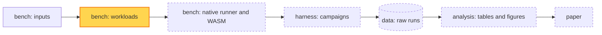

Talk to David in PT-PT; everything in the repo (code, PR title and body, comments) is English.
Never write the em dash. PR titles follow the `conventional-commits` skill.

## 1. Size

- **Soft ceiling of ~500 changed lines per PR, cut along module boundaries.** It is a ceiling,
  not a target: a 250-line module goes on its own and is never padded to reach 500.
- **Never split a file.** A module of ~550 lines that only makes sense whole goes whole.
- **Tests go in the same PR as the code they test.** If a module and its tests pass ~500,
  split by submodule, each with its own tests. Never a "code PR" followed by a "tests PR".
- **Mechanical PRs have no ceiling:** campaign specs (JSON), ADRs, the paper, `data/`. They are
  copies with nothing to review line by line, and splitting them only adds noise.
- **Every PR builds and passes CI on its own.** A PR brings the CI job for what it adds. If the
  dependency order forces two pieces together, put them together and tell David why.

Count with `git diff --stat main...HEAD` before opening. If it is well over ~500 and not
mechanical, split it before asking for review.

## 2. Branch and sequence

1. `git fetch` and `git switch -c <type>/<short-name> origin/main` (type as in the commit
   types, for example `feat/bench-input`).
2. PRs go one at a time: the next one is opened only after the previous one is merged. The next
   branch may be prepared locally while David reviews, then rebased on `main` after the merge.
3. Never push to `main`. David squash-merges; the PR title becomes the commit.

## 3. Description

Fill this in, in English:

```markdown
## Summary

Part of the final-repo stack, split into small PRs that each pass CI. Each PR only adds what
it describes; review them in order (part N of ~M).

<One paragraph: what this PR adds, in plain words, and what it does in the study. Say where
it comes from: the workload, the runner, the harness step, the analysis or the paper section.>

## Where it fits

<Mermaid diagram, see below>

<The paper figure or table this code produces, when there is one, see below>

## How it was verified

<The commands that were run and what they showed. Numbers from the Mac are never results.>
```

- "~M" is the current estimate of the total. Update it when the split changes; never promise
  an exact count.
- No attribution lines: no "Generated with", no `Co-Authored-By` for Claude or any AI.
- Link the ADRs the code follows (`docs/adr/NNNN-...md`) once they are in the repo.

### Mermaid diagram

GitHub renders Mermaid inside a ```` ```mermaid ```` block. Show the pipeline and highlight the
part this PR adds; keep the parts not yet merged dashed.

````markdown

````

Zoom in when it helps: for a PR inside one module, draw that module's own flow (the files and
how they call each other) instead of the whole pipeline.

### Paper figure

When the PR's code produces (or is measured in) a figure or table of the paper, show it.

- The figures are PDFs in `paper/figures/`; GitHub does not show PDFs inline. Convert to PNG:
  ```bash
  pdftoppm -png -r 150 -singlefile paper/figures/<name>.pdf <out-dir>/<name>
  ```
- Publish the PNGs on the orphan branch `pr-assets` (never on `main`), in a folder per PR:
  `pr-assets/<branch-name>/<name>.png`. Commit there with `chore: add figures for <branch>`.
- Reference the image by its raw URL, with a caption that says which figure of the paper it is:
  ```markdown
  

  *Figure 2 of the paper: produced by this PR's code from `data/raw/campaign-v3`.*
  ```
- If no figure comes from this code, leave the Mermaid diagram on its own. Never add a figure
  that this code does not produce.

## 4. Open and follow

1. Run locally what CI runs for the touched parts before pushing.
2. `git push -u origin <branch>` and `gh pr create --title "<conventional title>" --body-file <file>`.
3. Wait for CI. A red CI is fixed before anything else.

## 5. The claude[bot] review

The project was already reviewed in the working repo; this review is a double check.

- **Minor findings** (style, naming, wording, suggestions): ignore them. Do not reply and do not
  change the code.
- **A finding that looks critical** (a bug, a wrong number, a broken build, a threat to the
  measurement): stop and bring it to David first, with what the bot said and what you think.
  Do not reply on GitHub and do not change anything until you have talked.
- Every comment posted through David's account starts with `[claude]`. David resolves the
  threads.

## 6. Done

The PR is ready for David's merge when CI is green and the review has been read with him. After
the merge: `git switch main && git pull`, then start the next PR. Remind David to update
`AI_USE.md`.
