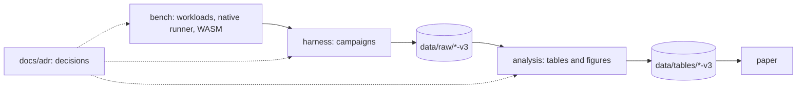

# Scalability of Parallel Code in WebAssembly in the Browser vs. Native

An empirical study of how the scalability (relative speedup and efficiency) of the same parallel
Rust/Rayon code differs between native execution and WebAssembly with threads in Chrome and
Firefox, and how much thread synchronization contributes to that difference.

- **RQ1:** How does the scalability of the same parallel code, run as WebAssembly in the browser
  and natively, evolve as the number of threads grows?
- **RQ2:** To what extent does synchronization between threads affect the gap observed in RQ1?

The workloads are a 3x3 Gaussian filter (embarrassingly parallel, the baseline) and an image
histogram, with shared padded atomic counters against per-task local counters, over inputs with
k in {1, 4, 16, 256} distinct values. The same source, compiler and release profile build the
native runner and the WASM package; what differs below the crate is listed in ADR 0076. Every
design decision, with its reasons, is a record in [`docs/adr/`](docs/adr/README.md).

## Provenance

Every number of the paper comes from one build, tagged `measured/v3` (commit `ac65af6a` of this
repository, built twice from scratch with equal digests, ADR 0086). This repository holds that
build's code and its measured data, `data/raw/*-v3` and `data/tables/*-v3` (see
[`data/README.md`](data/README.md)). The paper reports v3 by a rule fixed before its data existed
(ADR 0084, ADR 0095).

The study was first measured on an earlier build, `measured/v2`, whose primary conclusions v3
repeats. Its data, tables and campaign specs are at the tag `data/v2`; no table or figure
combines runs of the two builds (ADR 0062). The pilot data and the data of builds before v2 are
not part of this repository.

Code merged after the tag does not change the measured path. `scripts/codegen_diff.sh
measured/v3` compares the hot functions of a checkout with those of the tagged build; a change
that is not codegen-neutral makes a new build (ADR 0062). The script normalizes x86-64 listings;
on another host (such as an arm64 Mac) the native listings have to be compared by hand with
addresses normalized.

## Setup

Develop and test on any machine; measure only on the Linux PC (an i9-14900KF, ADR 0001).

```sh
make setup   # rustup, the pinned nightly, wasm-bindgen and the pinned browsers (no sudo)
make build   # the native runner and the WASM package
make test    # what CI runs, minus LaTeX
```

On the measuring PC, once, with sudo:

```sh
make deps sudoers chrome-apparmor
```

`sudoers` allows passwordless `systemd-run` and `systemctl` for the run scopes (ADR 0028): keep it
to the dedicated PC and remove it (`sudo rm /etc/sudoers.d/ppc-bench`) after the campaigns.

## How to run

| Command | What it does |
|---|---|
| `make env-setup` / `make env-restore` | Prepare the PC for measuring (SMT and turbo off, governor `performance`, P-cores shielded) and undo it |
| `make campaign SPEC=harness/campaigns/<name>.json` | Run a campaign: every run a fresh process, in a seeded random order, resumed if stopped |
| `make status SPEC=...` | Progress of a campaign, read-only |
| `make results` | Every table and figure of the main campaign, from `data/raw/campaign-v3` |
| `make all-results` | The same for every campaign, the exploratory ones and the hardware counters included |
| `make tables-check` | Regenerate every table and fail if one differs from the committed one |
| `make quick` | Tiny copies of every campaign, to check the pipeline end to end (never results) |

### Before a campaign on another machine

A campaign of the study needs more than the commands above:

- **Linux with systemd and a graphical session.** Each run is confined to a systemd scope, and
  the browsers start headless but still need the session's display variables.
- **sudo** for `make env-setup` and `make env-restore` (they write kernel settings and move
  system slices), and the `sudoers` rule above for the run scopes.
- **The CPU layout of this study is hard-coded in two places that must change together:**
  `P_MASK` and `E_CPUS` in the `Makefile` (the measured cores and the cores left to the system)
  and `cpus` and `harnessCpus` in every campaign spec. They describe an i9-14900KF: P-cores on
  the even CPUs 0 to 14, E-cores on 16 to 31.
- **Time.** The main campaign is 5310 runs and takes about 14 hours; it resumes if stopped.
- **Firefox must not update itself.** The harness now writes a `policies.json` that disables
  the updater and checks the pinned versions before a campaign (ADR 0071).

`make help` lists the rest. The campaigns are described in
[`harness/campaigns/README.md`](harness/campaigns/README.md).

### Checking SIMD by hand

CI checks that the filter's interior loop is vectorized on both sides (ADR 0017):

```sh
cd bench
objdump -d -C --no-show-raw-insn target/release/native > native.dis
python3 ../scripts/check_simd.py native.dis x86_64
wasm-objdump -d target/wasm32-unknown-unknown/release/bench.wasm > bench.wasm.dis
python3 ../scripts/check_simd.py bench.wasm.dis wasm32
```

## Repository layout

| Folder | Contents |
|---|---|
| `bench/` | Rust crate: workloads, native runner, WASM entry and benchmark page |
| `harness/` | Results server, browser launcher (no automation framework), environment control, campaign orchestrator and specs |
| `analysis/` | Statistics, inference, quality checks, tables and figures |
| `data/` | `raw/` (one folder per campaign, the measured runs) and `tables/` (derived from them) |
| `docs/adr/` | The decision records, with those of the exploratory campaigns in `extras/` |
| `scripts/` | Repository checks: ADR structure, SIMD, codegen diff, hardware counters |
| `paper/` | LaTeX: `final/` (the paper), `pilot/`, `proposal/`, with shared `figures/` and `bib/` |



Two options stay in the code without a measured campaign: the image `pitch` (row padding) and
the `consecutive` palette.

## License

The code is under the [MIT License](LICENSE). The measured data (`data/`), the decision records
(`docs/`) and the paper and reports (`paper/`) are under
[CC BY 4.0](https://creativecommons.org/licenses/by/4.0/): reuse them with credit (see
[`data/LICENSE`](data/LICENSE)).

## Use of AI

See [`AI_USE.md`](AI_USE.md).
