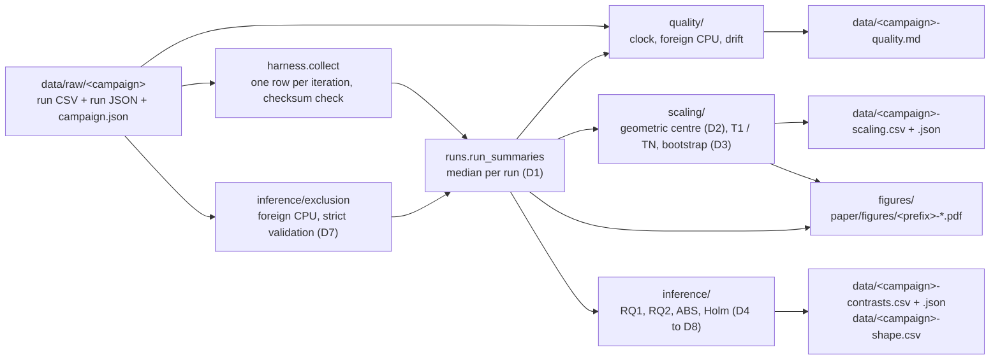

# analysis

Statistics and figures of the study: the same Rust/Rayon code measured
natively and as WebAssembly in Chrome and Firefox. Everything here reads the
raw runs of a campaign (`data/raw/<campaign>`) and writes tables to `data/`
and figures to `paper/figures/`. The statistics are fixed by the analysis
plan, written before the campaign data.

## Layout

The top-level modules are the commands; the subpackages are the library they
call. Every command runs as `python3 -m analysis.<command>` (the figure
commands through `uv run --no-project --with matplotlib`, see `Makefile`).

| Command | What it writes |
|---|---|
| `datacheck` | Data quality report of a campaign |
| `v0` | Speedup and efficiency per configuration, `<campaign>-scaling.csv` |
| `results` | The plan's RQ1, RQ2 and absolute contrasts, `<campaign>-contrasts.csv`, and the shape table |
| `robustness` | Mann-Whitney U and Cliff's delta on the 10 primary contrasts, Holm-adjusted, against the bootstrap decisions, `<campaign>-robustness.csv` |
| `karp_flatt` | Karp-Flatt serial fraction per configuration from a scaling table, `<campaign>-karp-flatt.csv` |
| `distributions` | Violins of the per-run medians for the filter and the atomic histogram, `<campaign>-distributions.pdf`, and their quartiles, `<campaign>-distributions.csv` |
| `iteration_drift` | First over last measured iterations per configuration |
| `extras.perf_counters` | Extra: hardware counters per atomic operation per run, from the perf-v2 campaign and its 100 ms perf intervals |
| `figures` | Speedup, efficiency, absolute ratio and RQ2 figures of a campaign |
| `extras.build_variants` | Extra: SIMD build variants table and figure |
| `cutoff` | Cutoff campaigns: table, break-even and worth-it sizes, fork-join model, figure |
| `grain` | Grain sweep campaigns: U-curve points, best grain and flat region, 100:1 grain, figure. `datacheck` pools the grains of a configuration, so its order-drift lines mix grains |
| `plot_warmup`, `plot_sizes`, `pilot_figures` | Pilot figures (the pilot data stays in the working repository) |
| `warmup`, `runcount`, `compare` | Pilot decisions: W, runs and iterations, pilot against pilot |
| `extras.jitdump` | Extra: one function's machine code from a V8 jitdump |

| Module or package | Concept |
|---|---|
| `configuration.py` | A configuration (environment, workload, input, k, N) and the names the plan refers to |
| `runs.py` | One value per run from the measured iterations |
| `campaign.py` | What a campaign directory holds: run contexts, `campaign.json`, pinned browsers |
| `provenance.py` | Commit and time stamp of a generated sidecar |
| `stats/` | Generic statistics: summaries, bootstrap, Holm, Spearman, skewness, Cliff's delta, Mann-Whitney U |
| `scaling/` | Speedup and efficiency tables |
| `inference/` | The plan's contrasts and the primary family |
| `quality/` | Clock, foreign CPU, order drift and iteration drift checks |
| `pilot/` | Rules that sized the campaign from the pilots |
| `figures/` | matplotlib figures |
| `tests/` | unittest suite (`python3 -m unittest discover -s analysis/tests -t .`) |

## Data flow

`results` removes the excluded runs before taking the run summaries; `v0`,
`datacheck` and `figures` use every run that did not fail.

## Conventions

- The run is the unit of analysis (Georges et al. 2007,
  https://doi.org/10.1145/1297027.1297033): iterations are summarised inside
  a run before any statistic across runs.
- Speedup is always relative to N = 1 of the same environment,
  and is read next to the absolute browser / native time (Hoefler
  and Belli 2015, https://doi.org/10.1145/2807591.2807644).
- Bootstrap: 95 % percentile intervals, 10 000 resamples, seed `0x5EED`,
  groups resampled independently (`stats/bootstrap.py`).
- Sidecar JSON files keep a fixed key order, so regenerating them changes
  only `commit` and `createdAt`.
- Type checking: `uv run --no-project --with mypy --with matplotlib mypy --strict analysis`.
