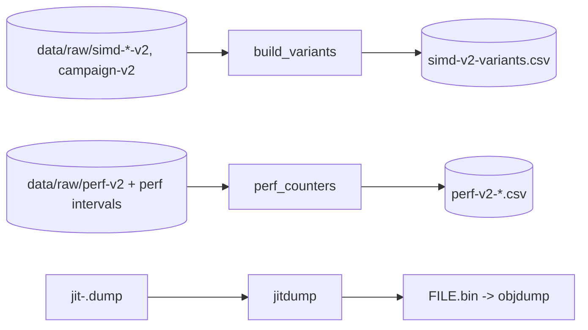

# analysis.extras

Analysis commands of the extras, not part of RQ1 or RQ2.

| Module | Command | What it writes |
|---|---|---|
| `build_variants.py` | `python3 -m analysis.extras.build_variants baseline=DIR scalar=DIR avx2=DIR --table T --figure F` | Filter scaling of the SIMD build variants against the baseline: efficiency, excess time and time over the baseline per build, environment and N (`simd-v2-variants.csv`) |
| `perf_counters.py` | `python3 -m analysis.extras.perf_counters data/raw/perf-v2 --runs R --summary S --retries T` | Hardware counters per atomic operation per run, from the 100 ms `perf stat` intervals that `scripts/perf-counters.sh` records next to the campaign |
| `variants.py` | `python3 -m analysis.extras.variants DIR --by engine-arm\|grain --output T` | Scaling of a campaign whose runs differ in a setting the configuration does not name: the engine arms of the tier campaign, the grains of the grain-by-threads campaign |
| `perf_loop.py` | `python3 -m analysis.extras.perf_loop FEW MANY --output T [--rises R]` | Counters per pixel of the loop alone, from two counter campaigns that differ only in passes (ADR 0090), and each counter at N threads over one thread |
| `core_split.py` | `python3 -m analysis.extras.core_split DIR --output T` | The one-thread run values by the core that did the work, from the busy time each run records |
| `jitdump.py` | `python3 -m analysis.extras.jitdump JIT_DUMP... --name SUFFIX --output FILE.bin` | The bytes of one function compiled by V8, read from a jitdump, to disassemble with `objdump` (the tool behind ADR 0060) |

`perf/` holds the pieces of `perf_counters`: `intervals.py` (the `perf stat` segments),
`run_counters.py` (a run's window, operations and counts per operation) and `tables.py` (the
three tables). The campaign itself is read through `analysis.loading`, like every other.

`make extras-results` runs the first, `make perf-results` the second; the third is run by hand.

