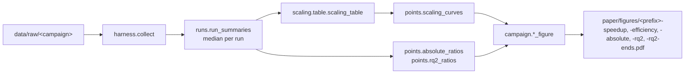

# analysis.figures

matplotlib figures of the paper. Only the modules that draw import
matplotlib; `points.py` is plain data, so the tests run without it.

| Module | Piece |
|---|---|
| `__main__.py` | The `figures` command: the four figures of a campaign |
| `points.py` | Points of the speedup, absolute ratio and RQ2 ratio curves |
| `style.py` | Colours, thread counts and sizes shared by the figures |
| `pyplot.py` | matplotlib with the Agg backend, chosen before pyplot is imported |
| `panels.py` | A grid of panels, the line-and-band plot, reference lines and the common finish |
| `campaign.py` | Speedup, efficiency, absolute ratio and RQ2 figures |
| `pilot.py` | The pilot report figure, in Portuguese and in English |
| `sizes.py` | Speedup at N = 8 against the image size |
| `warmup.py` | Warm-up curves with the chosen W |
| `build_variants.py` | Extra: filter efficiency per SIMD build |
| `cutoff.py` | Speedup against the image side, one panel per cutoff workload |
| `grain.py` | Time per pass against the grain, log-log, one panel per workload and size, adaptive split dashed; `sides` picks the paper's 8192^2 panels, in one row |
| `spread.py` | Plain data of the distribution figure: the four panels and each environment's run values in ms |
| `distributions.py` | Violins of the per-run medians, with median, interquartile box and every run as a dot (`distributions` command) |

Lines are geometric means of the per-run medians; bands are 95 % percentile
bootstrap intervals over runs.

