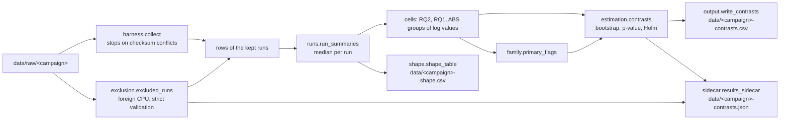

# analysis.inference

The contrasts of the analysis plan, on the
logs of the run values:

- RQ1: `[log T(browser, 1) - log T(browser, N)] - [log T(native, 1) - log T(native, N)]`,
  the log of the speedup ratio browser / native.
- RQ2: `[log T(browser, atomic) - log T(browser, local)] - [log T(native, atomic) - log T(native, local)]`
  at the same k and N.
- ABS: `log T(browser, N) - log T(native, N)`, exploratory.

Each contrast gets a 95 % percentile bootstrap interval. The primary family
(RQ2 at the maximum N for every k and browser, RQ1 for the filter on noise at
the maximum N: 10 contrasts) also gets a two-sided bootstrap p-value, Holm at
alpha = 0.05 and a Bonferroni interval at 99.5 %. Effects are reported as
`exp(estimate)`.

| Module | Piece |
|---|---|
| `question.py` | `Question`: RQ1, RQ2, ABS |
| `cells.py` | Log run values per configuration and the groups each contrast needs |
| `interaction.py` | The log centre and the two- or four-group contrast |
| `family.py` | Primary family, its size, alpha and the Bonferroni level |
| `contrast.py` | `Contrast`: estimate, intervals, p-values, decision |
| `estimation.py` | `contrasts`: bootstrap every contrast, then Holm over the family |
| `exclusion.py` | Runs excluded before the analysis (plan D7) and their counts |
| `shape.py` | Skewness of the run values and of their logs per configuration |
| `robustness.py` | Mann-Whitney U and Cliff's delta on the per-run ratios of the primary contrasts, Holm, re-pairing check |
| `output.py` | CSV columns and writers of the contrast, robustness and shape tables |
| `sidecar.py` | Options and outcome of a `results` call, and its JSON sidecar |

## Robustness check (Mann-Whitney U)

The bootstrap ratio intervals stay the primary analysis: run times are
skewed, the questions are about ratios, and an interval on the ratio says
how large the effect is, which a p-value does not. As a check with the
rank test the course recommends for timing data, `robustness.py` (command
`analysis.robustness`) tests each of the 10 primary contrasts with
Mann-Whitney U and gives Cliff's delta:

- per run, RQ1 takes `log(T1 / TN)` and RQ2 `log(T atomic / T local)`,
  pairing the two cells by repetition index (the `-rNN` of the run id);
- the browser's per-run values are compared with native's, unpaired: they
  are different processes;
- the 10 p-values are Holm-adjusted and the decisions are set next to the
  bootstrap's.

The campaign order is one full shuffle, so repetition r of two
configurations shares nothing: pairing by r is one arbitrary but fixed
pairing, chosen before looking at the values. `same_decision_share` is
the share of 1000 random re-pairings (seed `0x5EED`) that give the same
Holm decision, so a decision that depends on the pairing shows up.

