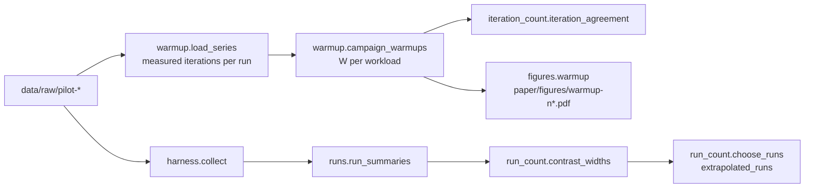

# analysis.pilot

The rules that sized the campaign from the pilot data. They are kept to
reproduce the pilot decisions, not run on the campaign.

| Module | Decision |
|---|---|
| `warmup.py` | Warm-up W per workload from long runs without warm-up |
| `run_count.py` | Runs per configuration from the half-width of the Bonferroni interval of every primary-style contrast over subsamples |
| `iteration_count.py` | Measured iterations per run from how often the first M iterations agree with the rest |

The commands are `analysis.warmup`, `analysis.runcount` and
`analysis.plot_warmup`; `analysis.compare` compares two pilots.
