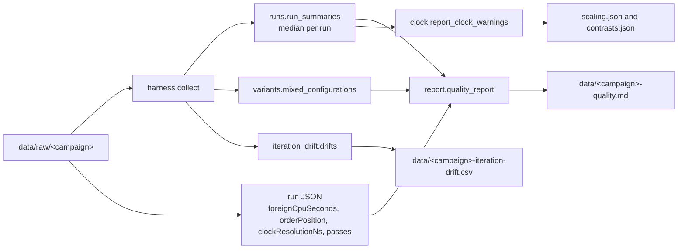

# analysis.quality

Checks on the data before and next to the analysis. Nothing here removes a
run; the exclusions are the plan's (D7) and live in `inference/exclusion.py`.

| Module | What it checks |
|---|---|
| `clock.py` | Configurations whose median timed sample (run value x passes K) is under 100 times the coarsest clock resolution of their runs |
| `foreign_cpu.py` | The foreign CPU threshold of 0.25 s |
| `order_drift.py` | Configurations whose run values trend with the execution order, Spearman's \|rho\| > 0.5 over at least 10 runs |
| `iteration_drift.py` | Median of the first measured iterations over the median of the last, pooled over runs |
| `gate.py` | The gate before a build's campaigns: no failed, missing or excluded run, one output per input across environments, thread counts and each sequential reference with its parallel workloads, every timed sample at least 100 times the clock resolution, first measured iterations within 5 % of the last |
| `variants.py` | Configurations whose runs differ in width, height, pitch, palette or passes, settings that `Configuration` does not name; they block the analysis. The grain may vary (grain sweep) |
| `report.py` | The data quality report of the `datacheck` command, including the runs set aside in `excluded/` for a re-run |

