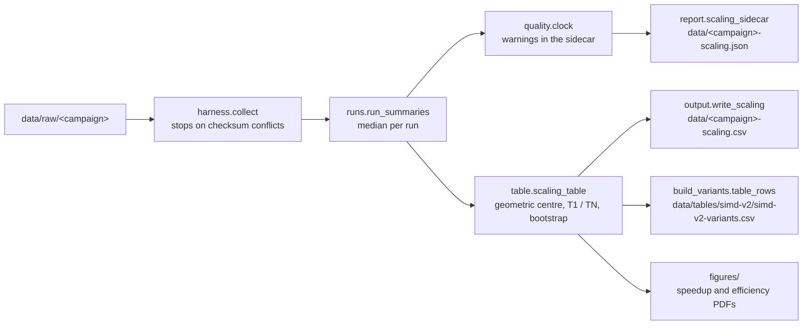

# analysis.scaling

Strong-scaling tables: per environment, workload, input,
k and N, the geometric mean of the run values, the speedup T1 / TN against
N = 1 of the same environment, and the efficiency speedup / N, each with a
95 % bootstrap interval over runs.

| Module | Piece |
|---|---|
| `table.py` | `ScalingRow` and `scaling_table`: speedup and efficiency with intervals |
| `output.py` | CSV columns and writer; `Scaling.WEAK` writes T1 / TN as the weak-scaling efficiency |
| `report.py` | `analyse` (collect, checksum check, clock check, table) and the `scaling.json` sidecar |
| `build_variants.py` | Extra: filter efficiency, excess time and ratios of the SIMD build variants |
| `cutoff.py` | `CutoffPoint`: T1, TN, speedup and work per region of one size |
| `crossing.py` | The break-even and worth-it sizes, interpolated on log size, and their rough side interval |
| `karp_flatt.py` | Karp-Flatt serial fraction e = (1 / S - 1 / N) / (1 - 1 / N) per configuration, from a scaling table (`karp_flatt` command) |
| `grain.py` | `GrainPoint` and `BestGrain`: time per pass against the task size, the minimum and its flat region |
| `fork_join.py` | Fork-join cost from the warm calibration calls and the model's predicted cutoff |

Used by the `v0`, `extras.build_variants`, `cutoff` and `grain` commands and by `figures/`.

## Cutoff

One campaign per image side; speedups are taken within a side only. A run
value is the time per pass, and one pass is one parallel region, so T1 per
pass is the work of a region. Per environment, workload and N > 1:

- break-even: the side where the speedup reaches 1;
- worth it: the side where the efficiency reaches `WORTH_IT_EFFICIENCY`
  (0.5), that is the speedup reaches N / 2.

Walking down from the largest side, the first pair of neighbouring sides
where the speedup goes from under the threshold to at or above it is
interpolated linearly in log side; a curve above the threshold at every
side is `below-smallest-size`, one under it at the largest side is
`above-largest-size`. `side_low` and `side_high` repeat the interpolation on
the upper and lower bounds of the speedup intervals: pointwise intervals, so
a rough guide, not a joint confidence interval.

The model takes TN = W / N + F, with F the fork-join cost at N = 8 (median
over runs of each run's median warm calibration call, as for the paper's
110, 60 and 7.5 us) and predicts the work W at which F is a share of TN:
first `RULE_OF_THUMB_SHARE` (1 %, the lecture's 100:1 rule), W = 99 N F,
then `LOOSE_SHARE` (5 %), W = 19 N F; each side is read off the largest
side's T1, scaled with the pixel count.

