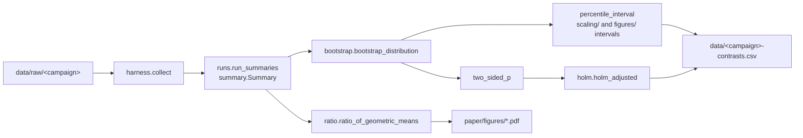

# analysis.stats

Generic statistics, with no knowledge of campaigns or configurations. The
rest of the package passes plain lists of run values in.

| Module | What it computes |
|---|---|
| `summary.py` | `Summary` (median, mean, geometric mean) and the plan's defaults: median per run (D1), geometric mean per configuration (D2) |
| `bootstrap.py` | Percentile bootstrap (Efron and Tibshirani 1993): resampled distribution, percentile interval, two-sided p-value; the plan's 95 %, 10 000 resamples and seed `0x5EED` (D3, D8) |
| `ratio.py` | Ratio of geometric means treatment / baseline with its bootstrap interval |
| `holm.py` | Holm 1979 step-down adjusted p-values |
| `spearman.py` | Spearman's rho with average ranks for ties |
| `skewness.py` | Moment coefficient of skewness |
| `cliff.py` | Cliff's delta |
| `mann_whitney.py` | Mann-Whitney U (Mann and Whitney 1947): average ranks, tie-corrected variance, two-sided p from the normal approximation with continuity correction (as `scipy.stats.mannwhitneyu(method="asymptotic")`) |

Every bootstrap draws the groups in the order they are passed, from one
`random.Random(seed)`, so the same input gives the same interval. Changing
the order of the groups changes the published numbers.
