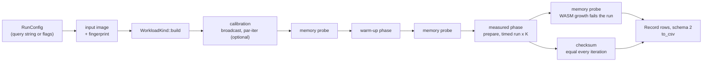
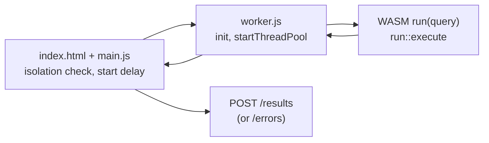

# bench

The Rust crate that holds the workloads and their measurement loop. The same
source builds two artifacts: the native runner (`src/bin/native`) and the
WASM library that the browser page loads (`src/wasm.rs`, `www/`). Both call
`run::execute`, so the timed region is the same code in every environment.

## Measurement

One call of `execute` is one run: it parses the configuration, generates the
input, optionally calibrates the fork-join cost with two probes, an empty
broadcast and an empty `par_iter`, then times the warm-up and
measured iterations as two phases. Only `Workload::run` is inside the timed
region; `prepare` (allocation and reset) and `checksum` are outside it.
`run` ends with the workload's final result stored (for the histograms, the
merged or read-back `Histogram`), so `checksum` only hashes it. With
`passes` K > 1 (default 1) each iteration calls `run` K times
between the clock reads and records the time per pass. Every iteration must
give the same checksum, and the input fingerprint and the checksum go into
every CSV row.

Between the phases, untimed, the host's `Platform` probes the memory size
(WASM linear memory, native resident set); a WASM run whose memory grew
during the measured phase fails. Every row also records the image buffer
addresses modulo 4096 and 64, the pitch, the palette, the passes, the grain
and the schema version (2); `src/results/README.md` lists the columns.

Every iteration is called from outside the Rayon pool (the native main
thread, the browser's coordinator worker), so each parallel region is
injected into the pool the same way in both environments.

## Browser

The harness serves `www/` cross-origin isolated and launches the browser on
`index.html` with the configuration in the URL. The page waits for the start
delay, runs everything in a module worker (the main thread cannot
`Atomics.wait`), and POSTs the CSV to the local server.

## Builds

| Variant | Command (from the repository root) | Output |
|---|---|---|
| Native, x86-64 baseline (SSE2) | `make build-native` | `target/release/native` |
| Native, 64-byte padding | `cargo build --release --bin native --features pad64` | `target/release/native` |
| Native, AVX2 extra | `make build-native-avx2` | `target/avx2/release/native` |
| Native, no auto-vectorization extra | `make build-native-scalar` | `target/scalar/release/native` |
| WASM, `simd128` | `make build-wasm` | `www/pkg/` |
| WASM, no `simd128` extra | `make build-wasm-scalar` | `www/pkg/` |

The WASM flags (threads, shared memory, `-Z build-std`) are in
`.cargo/config.toml`; the toolchain is pinned in `rust-toolchain.toml`.

## Layout

| Path | Responsibility |
|---|---|
| `src/lib.rs` | Module list |
| `src/config.rs`, `src/config/` | `RunConfig` from a query string or flag pairs |
| `src/input.rs`, `src/input/` | SplitMix64, `GrayImage` and the input generators |
| `src/experiment.rs`, `src/experiment/` | Names of environments, workloads and inputs |
| `src/workloads/` | The `Workload` trait, the checksum and the workloads; extras in `extras/` folders |
| `src/measurement.rs`, `src/measurement/` | Clocks, the measurement plan and the timed loop |
| `src/calibration.rs`, `src/calibration/` | Fork-join calibration before the workload |
| `src/results.rs`, `src/results/` | CSV schema and rows |
| `src/platform.rs`, `src/platform/` | `Platform`: the host's clock, memory probe and pause |
| `src/pool.rs`, `src/pool/` | The global pool's size and the thread-count check both hosts use |
| `src/test_support.rs` | Helpers shared by the unit tests (`cfg(test)` only): test pools, `prepare_and_run`, the sequential reference histogram |
| `src/run.rs`, `src/run/` | `run_in_pool` (the hosts' entry), `execute` (one run), `to_csv`, `RunError` and the `MemoryTracker` (memory probed at the phase hooks; growth while measuring fails a WASM run) |
| `src/build_info.rs`, `src/build_info/` | Compiler, flags and features as JSON |
| `src/wasm.rs`, `src/wasm/` | wasm-bindgen exports and the `performance.now()` clock |
| `src/bin/native/` | Native runner: flags, global Rayon pool, CSV on stdout |
| `www/` | Browser page and worker |
| `tests/native_runner.rs` | Runner end to end: CSV schema, checksums across thread counts |
| `tests/golden_checksums.rs` | Output checksums pinned before the readability refactor |
| `tools/golden_inputs.py` | Independent Python reference for the input fingerprints |
| `probes/rmw_chain.c` | Extra: microbenchmark of the k = 1 local-histogram increment sequences |
| `build.rs` | Records the rustc version, wasm-bindgen version and rustflags |

## Checks

- `make test-rust` runs the tests with the default build and with `pad64`.
- `make lint` runs rustfmt, clippy (`-D warnings`) and the repository checks.
- `scripts/check_simd.py` checks that `blur_interior` is vectorized.
- `scripts/codegen_diff.sh [BASE_REF]` builds a base ref and the working
  tree at the same path and compares the code of every function, so a change
  meant to be codegen-neutral can be checked.
