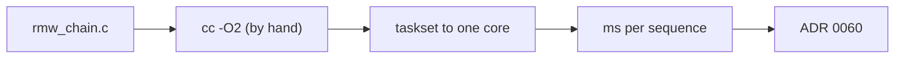

# probes

One-off microbenchmarks outside the study's workloads. Extra: not part of RQ1 or RQ2, and not
built by any target.

| File | What it is |
|---|---|
| `atomic_increment.c` | The shared atomic histogram with the increment sequences of LLVM and of V8's two compilers, on 1 and 8 pinned threads, to test whether those instructions explain the atomic histogram's times (ADR 0088). Its output and what it showed are in `data/probes/atomic-increment/` |
| `rmw_chain.c` | The increment sequences that LLVM and V8 emit for the k = 1 local histogram (one memory-operand `inc` against load, add, store), timed on one core. It is the probe behind ADR 0060; its recorded outputs stay in the working repository |

