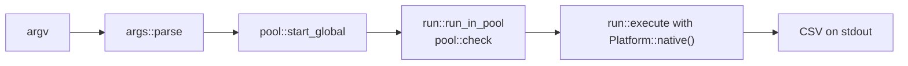

# native

The native runner. One process is one run: it parses the flags, builds the
global Rayon pool with the requested thread count (`pool::start_global`),
runs `run::run_in_pool` from the main thread (outside the pool) and prints
the CSV on stdout. Every option of `RunConfig` is a flag, `--passes K`
included. `--build-info` prints the build JSON with the clock
resolution instead.

| File | Responsibility |
|---|---|
| `main.rs` | Entry point, global pool, CSV or error exit |
| `args.rs` | `--key value` flags to `RunConfig`; the environment is always native |

