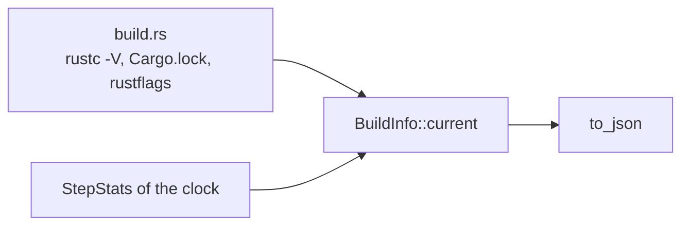

# build_info

What built the artifact: the rustc version, the wasm-bindgen version, the
rustflags (all captured by `build.rs`), the enabled features and, at run
time, the clock resolution. The harness stores it with every run.

| File | Responsibility |
|---|---|
| `../build_info.rs` | `BuildInfo` and its JSON |
| `json.rs` | `json_string`, a minimal JSON string escaper |

