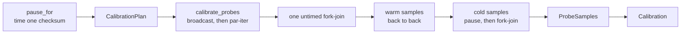

# calibration

Measures the cost of an empty fork-join before the workload, back to back
(warm) and after a pause (cold). Between measured
iterations the single-threaded checksum lets the Rayon workers fall asleep,
so each cold sample follows a pause at least as long as one checksum (1 ms
floor) and starts from the same sleeping pool.

Two probes are timed, both listed in `calibrate_probes`, in this order:

- `broadcast`: `rayon::broadcast` with an empty closure, which wakes every
  pool worker and waits for all of them (the cost the paper reports);
- `par-iter`: an empty `into_par_iter().for_each` over one item per pool
  thread, an ordinary optional-parallelism region that Rayon splits and
  steals like a workload's loop.

Each probe gets its own warm and cold samples; the CSV names the probe of
every calibration row (`probe` column).

| File | Responsibility |
|---|---|
| `../calibration.rs` | `calibrate_probes` (the probe list), `calibrate` (one probe), `pause_for` and `MIN_PAUSE_NS` |
| `fork_join.rs` | `ForkJoin` trait: the probe's name and its region |
| `probe.rs` | `Probe`: `Broadcast` or `ParIter`, and their CSV names |
| `empty_broadcast.rs` | `EmptyBroadcast` |
| `empty_par_iter.rs` | `EmptyParIter` |
| `pause.rs` | `Pause` trait and `ThreadSleep` |
| `plan.rs` | `CalibrationPlan` (samples, pause) and `Calibration` (the pause and every probe's samples) |
| `probe_samples.rs` | `ProbeSamples`: one probe's warm and cold samples |

