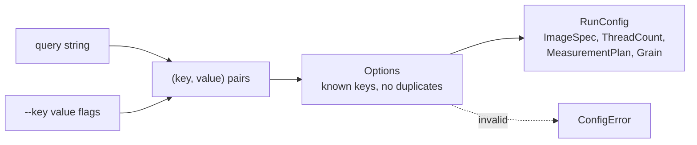

# config

Turns the run configuration into a `RunConfig`. The browser passes it as the
page's query string and the native runner as `--key value` flags; both end
in `RunConfig::from_pairs`, so the two environments accept the same options.

`pitch` (optional, filter only, at least the width) is the row stride of
the input and output images in bytes; absent, the rows are back to back as
before. The checksum and the input fingerprint cover only the width of each
row, so a padded run has the checksums of the unpadded one.

`palette` (optional, `input=few` only) is `spread` (default, values
i * 256 / k, the study's input) or `consecutive` (values 0..k-1), so the
packed histogram can be run with its k counters on shared cache lines.

`RunConfig` holds validated, typed values: the `ImageSpec` (input, width,
height, seed, pitch), the `ThreadCount` (never zero), the `MeasurementPlan`
(warm-up and measured iterations, passes; at least one measured iteration)
and the `Grain`. A `RunConfig` that exists is runnable, so `execute` checks
nothing again.

`passes` (optional, default 1) is the number of `run` calls per timed sample.
More than one pass is accepted only for the workloads whose
`WorkloadKind::capabilities()` declares `repeats_identically`, the filter and the local
histogram: each pass recomputes the same output from the input. The atomic
histograms add into counters that `prepare` resets only once per sample, and
a sort's second pass would sort sorted data, so for them `passes` > 1 is a
`ConfigError::Unsupported`.

| File | Responsibility |
|---|---|
| `../config.rs` | `RunConfig`, `from_query`, `from_pairs` and the run context |
| `image_spec.rs` | `ImageSpec`: the input image (input kind, size, seed) and `image()` to build it |
| `thread_count.rs` | `ThreadCount`: N, never zero |
| `error.rs` | `ConfigError` and its messages, including `Unsupported` (an option the workload does not take) |
| `options.rs` | `Options`: the known keys, duplicate detection and typed lookups |

