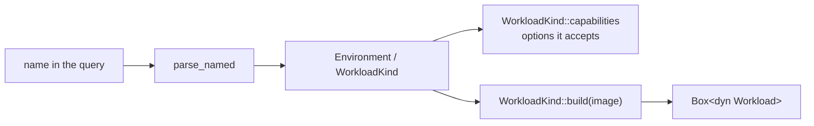

# experiment

The named factors of a run: the environment, the workload and the input. Each
has a fixed name that appears in the configuration and in the CSV.

| File | Responsibility |
|---|---|
| `../experiment.rs` | Module root and `parse_named`, shared by the `FromStr` impls |
| `environment.rs` | `Environment`: native, chrome, firefox |
| `workload_kind.rs` | `WorkloadKind`, `build`, which boxes the matching workload, and `capabilities()`, declared once per workload |
| `capabilities.rs` | `Capabilities`: whether a workload repeats identically (several passes), takes a grain and takes a pitch |
| `input_kind.rs` | `InputKind`: noise or few colors with k and a palette (`InputKind::few(k)` is the spread one), and the image it generates |
| `unknown_name.rs` | `UnknownName`, the parse error |

