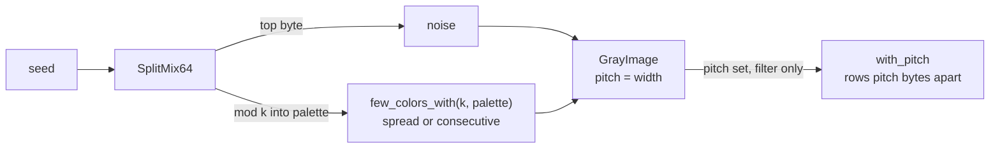

# input

Deterministic test images. The same seed gives the same pixels in every
environment, and `execute` records an FNV-1a fingerprint of the input in every
CSV row so that this can be checked.

| File | Responsibility |
|---|---|
| `../input.rs` | Module root: `SEED`, `MAX_COLORS` (256 grey levels), re-exports |
| `split_mix64.rs` | SplitMix64 generator with its published constants |
| `gray_image.rs` | `GrayImage`: width, height, pitch (row stride) and row-major pixels; `with_pitch` pads the rows, `fingerprint` hashes the rows without padding |
| `generators.rs` | `noise` (uniform bytes), `few_colors` (k evenly spaced levels) and `few_colors_with` (any palette, same random draws) |
| `palette.rs` | `Palette`: `spread` (i * 256 / k, the default) or `consecutive` (0..k-1) |

`bench/tools/golden_inputs.py` reimplements the generators in Python and
prints the fingerprints that `generators.rs` pins.

