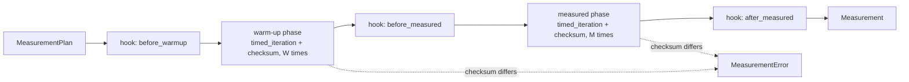

# measurement

The timed loop. `measure_with` runs two explicit phases, the warm-up
iterations and then the measured iterations; each iteration calls `prepare`
outside the timed region, then reads the clock, calls `run` K times (the
plan's `Passes`, 1 unless the run sets `passes`), reads the clock again
(`timed_iteration`). After each iteration it checks that the checksum equals
the first one. `PhaseHooks` are called before the warm-up, between the two
phases and after the last measured iteration, all outside the timed region;
`run::execute` uses them to probe the memory size. `measure` is
`measure_with` without hooks.

**Time per pass.** The recorded `ns` of an iteration is the time per pass:
the elapsed time between the two clock reads divided by K and rounded to the
nearest ns (half up). With K = 1 it is the elapsed time. The CSV format does not change; K is in the run's context JSON
(`passes`), so the analysis can recover the length of the timed sample,
`ns` x K.

| File | Responsibility |
|---|---|
| `../measurement.rs` | Module root and re-exports |
| `clock.rs` | `Clock` trait and `NativeClock` (`Instant`) |
| `step_stats.rs` | `StepStats`: smallest and most common clock step, `RESOLUTION_SAMPLES` |
| `plan.rs` | `MeasurementPlan` (warm-up and measured counts, passes) and `PlanError` |
| `passes.rs` | `Passes`: K >= 1 calls of `run` per timed sample, and the time per pass |
| `measure.rs` | `measure`, `measure_with`, `timed_iteration`, `Measurement` and `MeasurementError` (with `Display`) |
| `phase_hooks.rs` | `PhaseHooks`: before the warm-up, between the phases, after the measured phase |

The browser clock, `PerformanceClock`, is in `src/wasm/`.

`timed_iteration`: `prepare` (untimed), `now_ns`, `run` K times, `now_ns`,
then (stop - start) / K rounded to the nearest ns.
