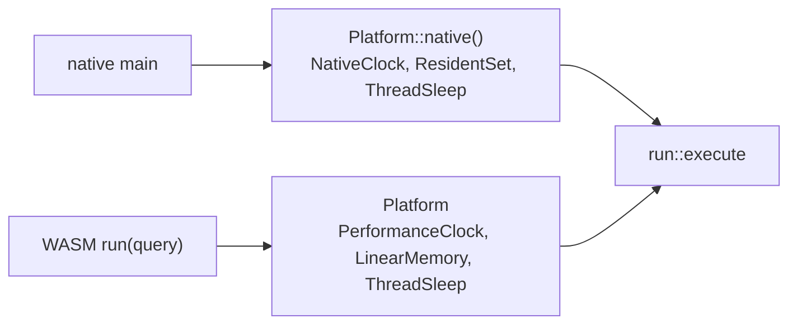

# platform

What a run needs from its host, as one `Platform` value: the clock, a probe
of the memory size and the pause used by the calibration. Each host builds
its own and passes it to `run::execute`; the shared code never asks which
environment it runs in.

| Host | Clock | Memory probe | Pause |
|---|---|---|---|
| Native (`Platform::native()`) | `NativeClock` (`Instant`) | `ResidentSet` (`/proc/self/statm`, recorded only) | `ThreadSleep` |
| Browser (`src/wasm.rs`) | `PerformanceClock` (`performance.now()`) | `LinearMemory` (`memory.size`; growth while measuring fails the run) | `ThreadSleep` |

| File | Responsibility |
|---|---|
| `../platform.rs` | `Platform<C, M, P>` |
| `memory_probe.rs` | `MemoryProbe`: memory size in bytes and whether growth fails a run |
| `resident_set.rs` | `ResidentSet`: the native process's resident set size |
| `native.rs` | `Platform::native()` |

The browser's `LinearMemory` and `PerformanceClock` are in `src/wasm/`.

