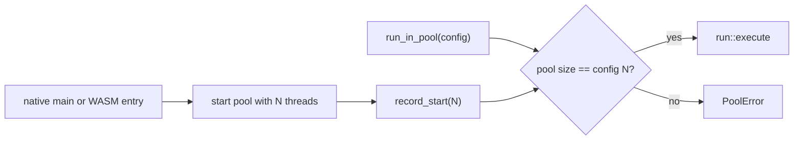

# pool

The Rayon pool of a run: started once per process (native) or per page (WASM), and checked
against the thread count each run asks for.

| File | Responsibility |
|---|---|
| `../pool.rs` | `start_global` (native) builds the global pool with N threads; `record_start` stores N (the WASM entry calls it after `wasm-bindgen-rayon` builds its pool); `check` refuses a run whose N is not the pool's |
| `error.rs` | `PoolError`: the pool could not be built, was never started, or has another size than the run asks for |

A pool of the wrong size would measure the wrong N without any error, so `run::run_in_pool`
calls `check` before every run.

