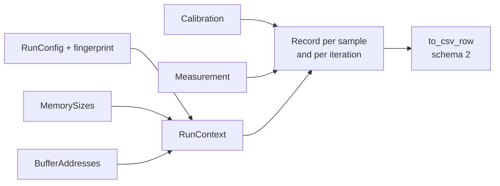

# results

The CSV schema shared by the native runner and the browser page. One row per
iteration (and per calibration sample), each carrying the full run context,
the input fingerprint and the output checksum. The `ns` of a warm-up or
measured row is the time per pass; with one pass, the default, it
is the time of the iteration.

## Schema

`SCHEMA_VERSION` is 3 (the v3 build). Schema 1, every build before v2, had the
first 13 columns only and no `schema` column; schema 2 (v2) appends the
columns up to `grain`; schema 3 appends `mem_before_measured_bytes`. A new
column always goes at the end, so the position of every earlier column is
unchanged. The harness reads schema 2 and 3 files and gives a schema 2 row an
empty value for the column it lacks (`harness/collect.py`). An absent value is
an empty field.

| Column | Schema | Meaning |
|---|---|---|
| `env`, `workload`, `input`, `k`, `width`, `height`, `seed`, `threads` | 1 | The configuration (`k` empty for noise) |
| `phase`, `iter`, `ns` | 1 | calibration-pause, calibration-warm, calibration-cold, warmup or measured; index in the phase; time in ns |
| `input_fingerprint`, `checksum` | 1 | FNV-1a of the input rows and of the output, as fixed-width hex |
| `probe` | 2 | Calibration warm and cold rows: `broadcast` or `par-iter`; empty otherwise |
| `mem_before_bytes`, `mem_after_bytes` | 2 | Memory before the warm-up and after the last measured iteration (WASM linear memory, native resident set; empty when unknown) |
| `input_addr_mod4096`, `input_addr_mod64` | 2 | Start of the input image buffer modulo 4096 and 64 (filter and histograms) |
| `output_addr_mod4096`, `output_addr_mod64` | 2 | Start of the output buffer modulo 4096 and 64 (filter only) |
| `pitch` | 2 | Row stride of the images in bytes (the width unless `pitch` was set) |
| `palette` | 2 | `spread` or `consecutive` for `input=few`; empty for noise |
| `schema` | 2 | The schema version |
| `passes` | 2 | `run` calls per timed sample |
| `grain` | 2 | Fixed task size; empty for Rayon's adaptive split |
| `mem_before_measured_bytes` | 3 | Memory after the warm-up, before the first measured iteration: equal to `mem_after_bytes` when the buffers were first touched in the warm-up |

| File | Responsibility |
|---|---|
| `../results.rs` | `SCHEMA_VERSION`, `CSV_HEADER` (read by `harness/tests/test_native.py`) and re-exports |
| `phase.rs` | `Phase`: calibration-pause, calibration-warm and calibration-cold (with their probe), warmup, measured |
| `run_context.rs` | `RunContext`: the run's `RunConfig`, input fingerprint, memory sizes and buffer addresses; turns a measurement into records |
| `record.rs` | `Record` and its CSV row, with 64-bit values as fixed-width hex and absent values as empty fields |
| `memory_sizes.rs` | `MemorySizes`: memory before the warm-up and after the last measured iteration |

