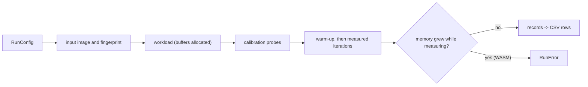

# run

One run, from a validated configuration to its CSV rows. The same `execute` runs natively and
in the browser; only the `Platform` (clock, memory probe, pause) differs.

| File | Responsibility |
|---|---|
| `../run.rs` | `run_in_pool` (checks the pool, then `execute`), `execute` (builds the input and the workload, calibrates, measures, turns the measurement into records) and `to_csv` |
| `error.rs` | `RunError`: a pool, measurement or memory problem that ends the run without rows |
| `memory_tracker.rs` | `MemoryTracker`: reads the memory size before the warm-up and around the measured phase; where the platform says growth fails a run (WASM linear memory), growth during the measured phase is an error |

The input image and the workload's buffers are built before the calibration, so no allocation
happens between the two clock reads of an iteration.

