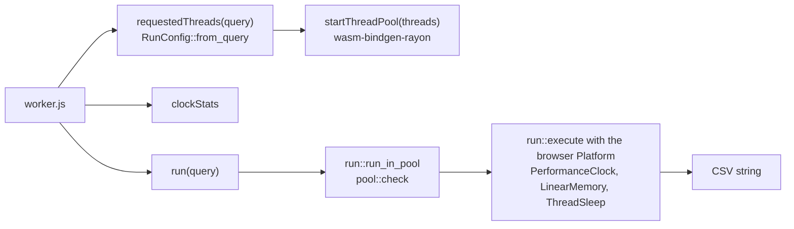

# wasm

The wasm-bindgen exports that `www/worker.js` calls. Built only for
`wasm32-unknown-unknown`.

| File | Responsibility |
|---|---|
| `../wasm.rs` | `requestedThreads` (the config's N, parsed by `RunConfig`), `startThreadPool`, `run`, `clockStats` (resolution and smallest step from one sampling, JSON), `buildInfo` |
| `performance_clock.rs` | `PerformanceClock`: `performance.now()` in nanoseconds |
| `linear_memory.rs` | `LinearMemory`: the byte length of the linear memory, the browser's `MemoryProbe` |

`startThreadPool` records the pool size in `pool`; `run` goes through
`run::run_in_pool`, which refuses to start unless the pool was started with
the configuration's thread count (the same check as the native runner).

