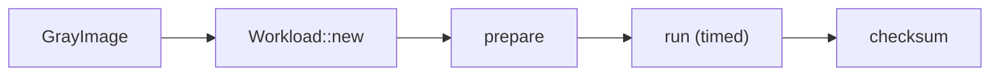

# workloads

Every workload implements `Workload`: `prepare` resets state outside the
timed region, `run` is the timed parallel work and ends with the final
result stored, and `checksum` only fingerprints that stored result so it can
be compared across environments and thread counts. For the histograms the
final result is the `Histogram`: the reduce of the local variant, the merge
of the private variant's per-thread tables, the read-back of the shared
counters of the atomic and packed variants; all of it is timed.

| File | Responsibility |
|---|---|
| `mod.rs` | Module list and re-exports |
| `workload.rs` | `Workload` trait |
| `buffer_addresses.rs` | `BufferAddresses`: where the input (and the filter's output) buffer starts, for the 4K-aliasing analysis |
| `checksum.rs` | `Checksum` of a byte slice, of fixed-size words or of several slices, streamed without a buffer |
| `fnv1a.rs` | `Fnv1a`: 64-bit FNV-1a fed piece by piece |
| `grain.rs` | `Grain`: Rayon's adaptive split or a fixed task size; `chunk_len` and `tasks`, the one split helper the filter and the atomic and local histograms share |
| `gaussian.rs`, `gaussian/` | 3x3 Gaussian blur, the embarrassingly parallel baseline, and `gaussian/sequential.rs`, the same filter without Rayon |
| `histogram/` | Image histogram: shared atomics, per-task local counters and variants, and `sequential.rs`, one plain table without Rayon |
| `extras/` | Workloads outside RQ1 and RQ2: `sort.rs`, Rayon's stable and unstable parallel sort |

