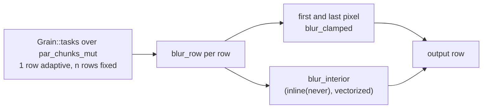

# gaussian

3x3 Gaussian blur with clamped borders. Each output row is independent, so
Rayon splits the output by rows; the interior of each row goes through
`blur_interior`, the loop that `scripts/check_simd.py` checks for SIMD.
With a `pitch`, the input and output rows are `pitch` bytes apart and only
the first `width` bytes of each output row are written and checksummed.

| File | Responsibility |
|---|---|
| `../gaussian.rs` | `GaussianBlur`, `blur_row` and `blur_interior` |
| `kernel.rs` | The binomial kernel, tap offsets, normalization and the clamped border pixels |
| `sequential.rs` | `SequentialBlur`: the filter in one plain loop on the calling thread, the reference without Rayon (one thread only). It shares `blur_interior` and keeps its own copy of the row and border handling, so that the parallel filter's functions keep a single caller |

