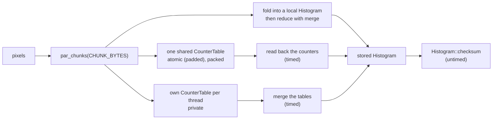

# histogram

256-bin histogram of the image, the RQ2 workload. The variants differ only in
how threads share the counters, so the ratio of their times isolates the
cost of synchronization.

| File | Responsibility |
|---|---|
| `mod.rs` | `Histogram` (counts, merge, checksum), `BINS` and `CHUNK_BYTES` (read by `harness/tests/test_browser_check.py`) |
| `atomic.rs` | `AtomicHistogram`: one shared table of padded atomic counters |
| `local.rs` | `LocalHistogram`: per-task counters with fold and reduce, the control |
| `extras/` | Variants outside RQ1 and RQ2: `private.rs`, `packed.rs` and the `packed_counter.rs` layout |
| `counter.rs` | `Counter`: the layout of one shared counter (an `AtomicU64` inside) |
| `counter_table.rs` | `CounterTable<C>`: exactly `BINS` counters (no bounds check on a `u8` index), `reset`, `increment`, `read` |
| `padded_counter.rs` | `PaddedCounter` (one counter per cache line) and `CACHE_LINE_BYTES` (128) |

