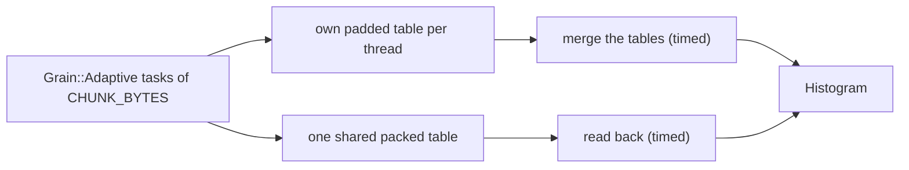

# histogram/extras

Histogram variants outside RQ1 and RQ2. They count the same image into the
same `Histogram` as the core variants, so their checksums are checked against
the local and atomic ones in the tests.

| File | Responsibility |
|---|---|
| `private.rs` | `PrivateAtomicHistogram`: one padded atomic table per pool thread, merged in the timed region; separates the cost of the atomic instruction from the cost of contention |
| `packed.rs` | `PackedAtomicHistogram`: the shared atomic table without padding, to measure false sharing |
| `packed_counter.rs` | `PackedCounter`: eight counters per cache line |

