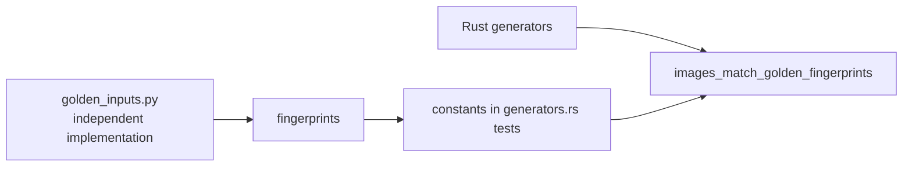

# tools

| File | What it does |
|---|---|
| `golden_inputs.py` | Reimplements SplitMix64 and the two input generators in Python and prints the FNV-1a fingerprints that `bench/src/input/generators.rs` pins, so that test does not check the Rust code against itself. Run: `python3 bench/tools/golden_inputs.py` |

