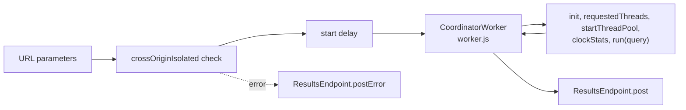

# www

The browser page. The harness serves this directory with COOP/COEP headers
(cross-origin isolation, needed for SharedArrayBuffer) and opens
`index.html?run=<id>&startDelayMs=<ms>&<config>`. `pkg/` is the
wasm-bindgen output of `build-wasm.sh` and is not tracked.

`main.js` removes `run` and `startDelayMs` and hands the rest of the query to
the worker unchanged, so every option of `RunConfig` (`passes` included)
reaches `run(query)` without a change here.

| File | Responsibility |
|---|---|
| `index.html` | Loads `main.js` as a module; the title shows the state |
| `main.js` | Run id and start delay from the URL, isolation check, then worker and POST |
| `page_status.js` | `PageStatus`: page title and status text |
| `page_error.js` | `PageError`: an error that carries metadata to the server |
| `coordinator_worker.js` | `CoordinatorWorker`: one module worker per run, resolves with its result |
| `results_endpoint.js` | `ResultsEndpoint`: POST to `/results` or `/errors` with the user agent |
| `worker.js` | Loads the WASM, starts the pool with `requestedThreads(query)` (parsed in Rust), reads `clockStats` once, calls `run` |

The worker exists because the page's main thread cannot block in
`Atomics.wait`, which the Rayon pool needs.

