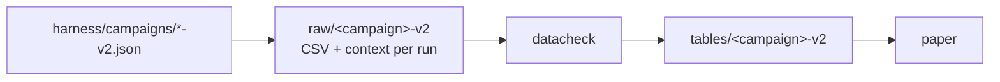

# data

The measured runs of the final build, `measured/v2`, and the tables derived
from them. The paper's numbers come from here.

| Folder | Contents |
|---|---|
| `raw/<campaign>-v2/` | One CSV (the run's rows) and one JSON (the run's context) per run, plus `campaign.json` (the spec and build it ran with) and `campaign.jsonl` (the journal, one line per run in execution order) |
| `raw/<campaign>-v2/excluded/` | Runs kept but left out of the analysis, each with its reason in the folder's README |
| `raw/<campaign>-v2/discarded/` | The discarded first browser launch of each session |
| `tables/<campaign>-v2/` | What `make results` (and the other result targets) writes from `raw/`: quality report, scaling table, contrasts, robustness, shape, and the sidecar JSON of each |

The campaigns are described in `harness/campaigns/README.md`. The extras
(`extras-v2`, `weak-v2`, `simd-*-v2`, `hybrid-v2`, `perf-v2`) are not part of
RQ1 or RQ2. The pilot data and the data of earlier builds stay in the working
repository.

Every table can be regenerated from `raw/` with `make all-results`; the
sidecar JSON files keep a fixed key order, so a regeneration changes only
their `commit` and `createdAt`.

