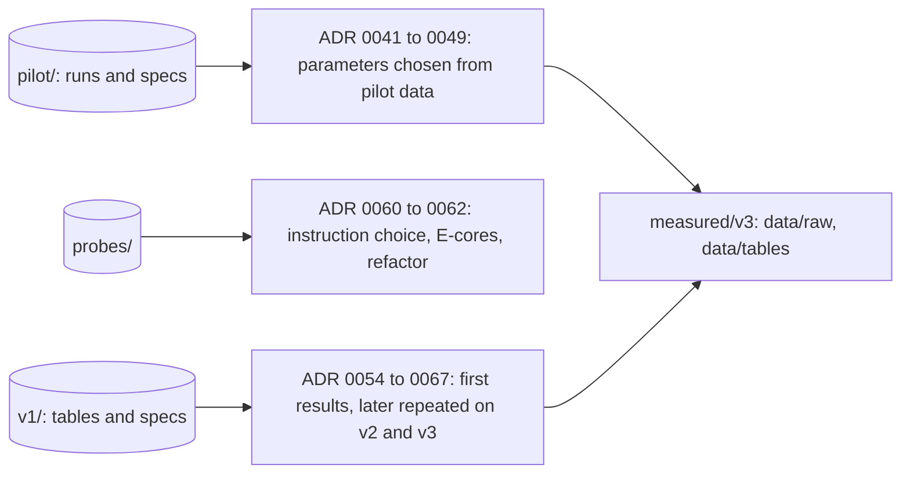

# data/earlier

Evidence from before the final build that the decision records in `docs/adr/` cite: pilot
runs, one-off probes, and the tables of the builds that came before `measured/v2`. It backs
decisions (image size, warm-up, thread counts, mask, run count, padding, cutoff, grain). None
of it is a result of the paper, and no command of `make` reads it.

| Folder | Contents | Cited by |
|---|---|---|
| `pilot/<name>/` | The runs of each pilot of 2026-11-06 and 07, as the harness of that day wrote them (CSV and context per run, the journal) | ADR 0041 (size), 0043 (warm-up), 0044 (threads), 0045 (mask), 0046 (headless), 0047 (run count), 0049 (padding, counters), 0053 (`pw-extras`) |
| `pilot/specs/` | The campaign spec of each pilot | the same records |
| `probes/` | Machine code of the k = 1 local histogram loop natively and in V8, the read-modify-write microbenchmark on P-cores and E-cores, the native workloads on one E-core, and the A/B of the refactor | ADR 0060, 0061, 0062 |
| `v1/tables/` | The tables of the first full campaigns (main, cutoff, grain, extras, weak, SIMD, hybrid), each on the build its record names | ADR 0054, 0056, 0058, 0061, 0065, 0067 |
| `v1/specs/` | The specs of those campaigns | ADR 0064, 0066 |

What is not here: the raw runs of the campaigns before v2 (only their tables are), and the
figures. The data, tables and specs of `measured/v2` are at the tag `data/v2`.

The files are copies and were not regenerated. The pilot runs have the CSV schema of their day
(13 columns, no `schema` column). They are kept to be read, never to be mixed with a campaign
of another build (ADR 0062).

