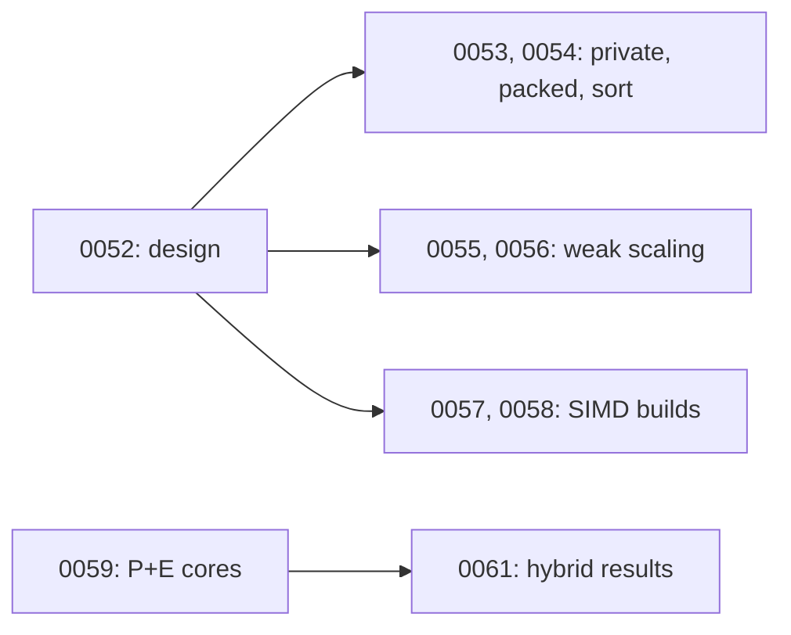

# Extras decision records

The decisions of the extra experiments: exploratory campaigns outside RQ1 and RQ2, outside the
family of primary contrasts and reported with 95 % intervals (ADR 0052). They keep the
numbering of the main records, so a reference such as "ADR 0054" reads the same everywhere.

| ADR | Decision |
|---|---|
| [0052](0052-extras-design.md) | Design of the extra experiments |
| [0053](0053-extras-campaign-parameters.md) | Parameters of the extras campaign |
| [0054](0054-extras-results.md) | Results of the extras campaign |
| [0055](0055-weak-scaling-campaign.md) | Weak scaling campaign |
| [0056](0056-weak-scaling-results.md) | Weak scaling results |
| [0057](0057-simd-campaigns.md) | SIMD campaigns |
| [0058](0058-simd-results.md) | SIMD results |
| [0059](0059-hybrid-campaign.md) | Hybrid P+E campaign |
| [0061](0061-hybrid-results.md) | Results of the hybrid P+E campaign |

