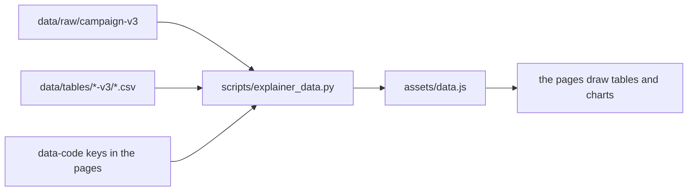

# Explainer

The documentation of the study: a set of HTML pages that explain the questions, the concepts, the
method, the results and the code, in reading order. Open `index.html` in a browser. It works
offline from `file://` (no build step, no CDN, no external fonts), on a phone too.

## Files

| File | What it holds |
|---|---|
| `index.html` and the other `*.html` | One page each, in the order of the menu (`PAGES` in `assets/app.js`) |
| `assets/app.js` | Shared behaviour: the menu and page outline, search (`/`), theme, glossary pop-ups, source lines, code excerpts, and the widgets (`UI.table`, `UI.bars`, `UI.stepper`, `UI.trace`, `UI.clickable`, `UI.segmented`) |
| `assets/style.css` | Shared styles: light and dark tokens, one colour per environment (`--native`, `--chrome`, `--firefox`) |
| `assets/data.js` | Generated: every number and code excerpt the pages show (`window.PPC`). Never edited by hand |
| `assets/glossary.js` | Hand-written: every term, its definition and the page that explains it |

## Where the numbers come from



- `python3 -m scripts.explainer_data` (or `make explainer`) writes `assets/data.js` from the
  `measured/v3` tables, the fork-join calibration of `data/raw/campaign-v3`, and the code excerpts
  the pages ask for. `--check` fails if the file is out of date.
- A page reads a table with `UI.rows("campaign-v3-scaling", {workload: "filter"})` or `UI.row(...)`,
  and shows its source with `<p class="src" data-src="campaign-v3-scaling"></p>`.
- A code excerpt is `<div data-code="bench/src/path.rs|literal start of the first line|12"></div>`:
  the file, a substring of the line where it starts, and how many lines. The generator fails if
  the substring is no longer found or is on more than one line, so excerpts follow the code. A
  leading `^` matches the start of a line (`^{` for the top of a JSON file).
  Pick a substring without `&`, `<` or `>`: the generator reads the raw HTML, so an entity such as
  `&amp;` would not match the code.
- Every reported number is from `measured/v3`. Pilot numbers appear only where they justify a design
  decision, and say so.

## Who it is for

Two readers at once: a junior who has never heard of a thread, a cache or a median and has to join
the project, and someone from the field who wants the detail. Both read the same page, in two layers.

## Writing a page

Copy the head, top bar, sidebar, pager and scripts of `index.html`. Set `data-page` to the page's
`id` in `PAGES` (`assets/app.js`), and give every `<h2>` the `id` of its section there, in that
order. `?static` turns animations off (for screenshots).

The order inside a page is always: why, then what, then the number. Never a number before the
reader knows what it measures.

**Layer 1, plain first.** Every section opens in plain words, as if to someone with no
background: short sentences, one idea each, an everyday example before the real one. No term is
used before it is explained, either on the page, on a Foundations page it links to, or by a
glossary pop-up (`<span data-term="id">`) on its first use. The lead paragraph and the
`oneliner` box say the page's idea with no numbers.

**Layer 2, for those who know.** Formulas, big tables, flags, the algebra, the ADR by ADR
detail, the contrast tables go inside

```html
<details class="deeper"><summary>If you already know this: the formula and the code</summary>
  ...
</details>
```

A junior skips it; an expert opens it. Everything that was in a page before the rewrite is still
there, inside one of these, unless it was wrong or duplicated.

**Components.**

- `<div class="why"><b>Why 30 runs and not 5?</b> ... what would go wrong without it ...</div>`:
  every design decision gets the junior's question and the failure story (if we did not, the
  numbers would say X and we would conclude Y, wrongly), then the ADR link.
- `<div class="analogy"><b>Picture it.</b> ...</div>`: one everyday analogy per hard idea.
- `<figure class="figure"><svg ...></svg><figcaption>...</figcaption></figure>`: a small inline
  picture, drawn by hand in SVG, for anything spatial (cores, lines, a pipeline).
- `<span class="def"><b>Term.</b> ...</span>`: a word explained where it is first used.
- `<div class="remember"><b>What to remember.</b> ...</div>`: the one thing, at the end.
- `UI.stepper`, `UI.trace`, `UI.segmented`, `UI.bars`, `UI.table`, `UI.clickable`: the widgets.

**Numbers.** Every measured number comes from `data.js` (`UI.row`, `UI.rows`) with a `data-src`
line. Made-up numbers for a worked example are allowed and must say so ("say 4 s and 1 s").
Nothing from a pilot or an earlier build as a result.

**Glossary.** `assets/glossary.js` has, per term, `def` (one plain sentence for the pop-up, no
jargon inside it) and `more` (a short paragraph with an example, shown on the glossary page).
