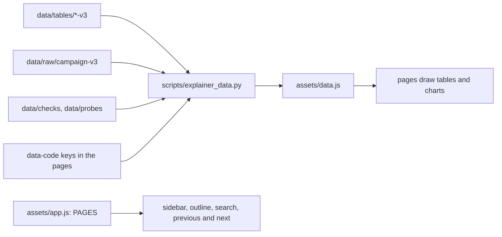

# Documentation

The documentation of the study: what it asks and found, the concepts it rests on, its design,
its results, task guides and reference pages. Open `index.html` in a browser. It works offline
from `file://`: no build step to read it, no CDN, no external fonts.

Every number comes from the build `measured/v3` (ADR 0095).

## Structure

Six groups, in the order of the sidebar. A page has one job: it teaches a concept, describes
the design, reports results, walks through a task, or is looked up.

| Group | Pages | What goes here |
|---|---|---|
| Getting started | `index`, `setup`, `code` | What the study is and found, a working checkout, the repository tour |
| Concepts | `machines`, `memory`, `compilers`, `threads`, `atomics`, `measuring`, `ratios`, `validity`, `rust` | Ideas a newcomer needs before the design makes sense. No measured numbers: a concept page links to the Study or Results page that has them |
| The study | `questions`, `workloads`, `environments`, `machine`, `protocol`, `reading` | The design and why: questions, workloads, environment control, run protocol, analysis plan |
| Results | `rq1`, `rq2`, `explains`, `extras`, `threats` | What was measured, what explains it, what it cannot establish |
| Guides | `campaigns`, `reproduce`, `workload`, `changing`, `debugging`, `trace`, `session`, `workflow` | One task each, in the order you would do it |
| Reference | `commands`, `spec`, `data`, `decisions`, `lectures`, `glossary` | Looked up, not read through: commands, files and schemas, decision records, terms |

The sidebar, the previous and next links and the search index are built from `PAGES` in
`assets/app.js`: one entry per page with its group, title and sections.



## Files

| File | What it holds |
|---|---|
| `*.html` | One page each |
| `assets/app.js` | The shell (sidebar, "On this page" outline, search, theme, previous and next, copy buttons, the list of sources at the end of a page) and the widgets (`UI.table`, `UI.bars`, `UI.stepper`, `UI.trace`, `UI.clickable`, `UI.segmented`, `UI.code`) |
| `assets/style.css` | One neutral palette with a single accent, light and dark; the colours `--native`, `--chrome` and `--firefox` are for data only |
| `assets/data.js` | Generated: every number and code excerpt the pages show (`window.PPC`). Never edited by hand |
| `assets/glossary.js` | Hand-written: every term, its one-sentence definition, a paragraph with a project example, and the page that explains it |

## Where the numbers come from

- `make explainer` (`python3 -m scripts.explainer_data`) writes `assets/data.js` from the v3
  tables, the fork-join calibration of `data/raw/campaign-v3`, the per-core check, the atomic
  increment probe and the code excerpts the pages ask for. `--check` fails if the file is out of
  date; `make lint` and CI run it.
- A page reads a table with `UI.rows("campaign-v3-scaling", {workload: "filter"})` or `UI.row(...)`
  and names it with `<p class="src" data-src="campaign-v3-scaling"></p>`. Files and decision
  records are named with `<p class="src" data-files="docs/adr/0037-analysis-plan.md"></p>`. The
  shell collects every such line into "This page rests on" at the end of the page.
- A code excerpt is `<div data-code="bench/src/path.rs|literal start of the first line|12"></div>`:
  the file, a substring of the line where it starts, and how many lines. The generator fails if
  the substring is not on exactly one line, so excerpts follow the code. A leading `^` matches
  the start of a line. Pick a substring without `&`, `<`, `>` or `|`.
- No measured number is typed into a page when a table has it. A made-up number for a worked
  example says so. Nothing from a pilot or an earlier build is shown as a result.

## Page anatomy

Every page has the same parts, in this order.

1. **Title and lead.** `<h1>`, then `<p class="lead">`: one or two sentences that say what the
   page gives the reader.
2. **Sections.** `<h2 id>` and `<h3 id>` with short paragraphs. The ids feed the outline and
   the search, so every `h2` and `h3` outside a collapsed block has one.
3. **In depth, last.** The plain explanation comes first. Formulas, full tables, flags and the
   record-by-record detail go in a section at the end or in a collapsed block,
   `<details class="deeper"><summary>In depth: ...</summary>`, placed after the paragraph it
   deepens and never before it.
4. **Sources.** A `src` line under each table, chart or claim that rests on a file.

Copy the head, the top bar, the `shell` block and the scripts from an existing page, set
`data-page` to the page's id, and add the page to `PAGES`.

### Callouts

Three kinds only, used sparingly:

```html
<aside class="callout note"><p class="callout-title">Note</p><p>...</p></aside>
<aside class="callout warning"><p class="callout-title">Warning</p><p>...</p></aside>
<aside class="callout why"><p class="callout-title">Why</p><p><b>The question.</b> The reason
  for the decision, what would go wrong without it, and its ADR.</p></aside>
```

Anything else is prose. An analogy is a sentence, not a box.

### Code, tables, figures

- Commands and code go in `<pre>` (the shell adds a language label and a copy button; set
  `data-lang` when the guess would be wrong) or in a `data-code` excerpt. File paths and
  identifiers are inline `<code>`.
- Anything tabular is a table: `UI.table` for data, a plain `<table>` for fixed text.
- One figure per mechanism or flow: inline SVG inside `<figure class="figure">`, drawn with the
  page's neutral tokens, or a widget. Charts use the environment colours and nothing else.

### Writing

- Second person, present tense, short sentences, no filler.
- Explain a term at its first use or mark it with `<span data-term="id">`, which opens its
  glossary definition. One name per concept across all pages, the one in the glossary.
- Why, then what, then the number: never a number before the reader knows what it measures.
- State each explanation at its level: measured, tested by an intervention, supported by
  measurements that agree, or open.
- English, and a plain hyphen, never the em dash.
