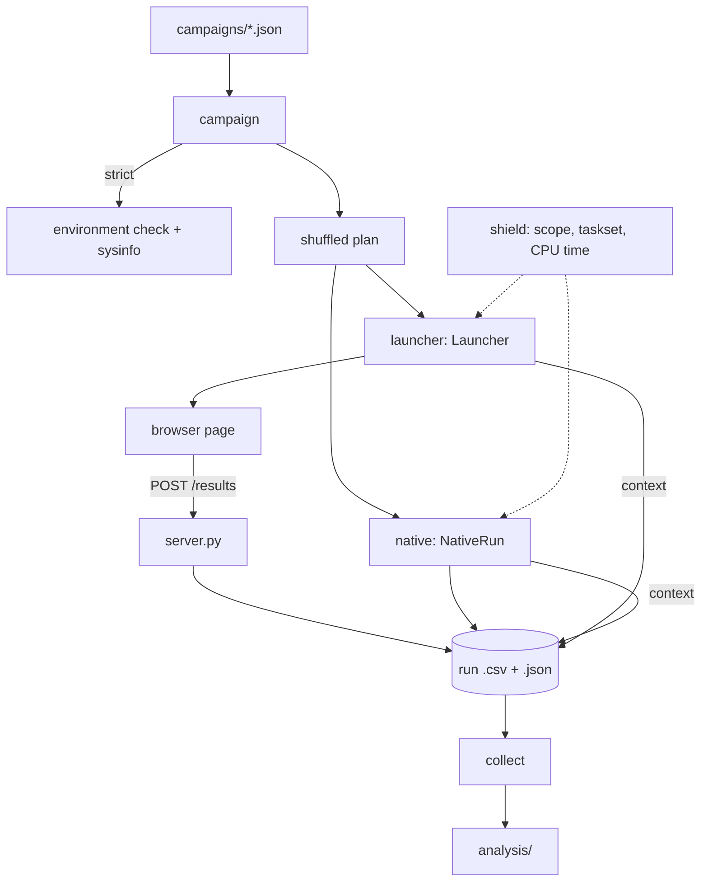

# harness

The harness orchestrates the measurements. It never measures anything
itself: the Rust code in `bench/` times its own iterations, natively or
as WebAssembly in a browser page. The harness starts each run in a
controlled way, stores what the run produced together with the context it
ran in, and joins the stored runs into one table for `analysis/`.

## Entry points

| Command | What it does |
|---|---|
| `python3 -m harness.campaign SPEC.json` | Runs a whole campaign, resumable |
| `python3 -m harness.campaign.status SPEC.json` | Progress of a campaign, running or finished; read-only |
| `python3 -m harness.launcher ...` | Launches one browser run |
| `python3 -m harness.native ...` | Runs the native runner once |
| `python3 -m harness.collect DIR` | Joins a campaign's runs into one CSV table |
| `python3 -m harness.environment mask\|check` | Prints the P-core mask or checks the machine |
| `python3 -m harness.shield check --cpus MASK` | Checks the cgroup CPU shield |
| `python3 -m harness.browser_check` | CI correctness check: browsers against native |
| `python3 harness/server.py` | Serves the page cross-origin isolated and stores results |
| `python3 harness/browsers.py` | Downloads the pinned browser builds |

`server.py` and `browsers.py` use the standard library only, so they also
run as plain scripts.

## Main pieces

| Path | Responsibility |
|---|---|
| `campaign/` | Campaign spec, shuffled plan, executors, journal and resume; `status/` reports progress |
| `launcher/` | One browser launch: command line, profile, waiting, teardown |
| `native/` | One native run, stored like a browser run |
| `context/` | Run context, host state, provenance, result files and validation |
| `shield/` | CPU shield, systemd run scope, CPU time and escaped processes |
| `environment/` | Machine check and the `sysinfo` record |
| `browser_check/` | Cases and comparison of the CI correctness check |
| `server.py` | Local results server with COOP/COEP |
| `browsers.py`, `browsers.json` | Pinned browser builds and their checksums; Firefox gets a policy that turns off its self-update |
| `collect.py` | Loader that joins runs and reports failed, missing and conflicting runs |
| `paths.py` | Repository paths the harness reads or launches |
| `campaigns/` | Campaign specs (JSON) |
| `env/` | Shell scripts that prepare and restore the machine |
| `tests/` | Unit tests (`python3 -m unittest discover -s harness/tests -t .`) |

## Flow

## Output files

Per run, in the results directory: `<run>.csv` and `<run>.json` when it
succeeded, `<run>.error.json` when it failed, and `<run>.browser.log` for a
browser run that did not finish. A campaign adds `campaign.json` (spec,
build identity, plan), `campaign.jsonl` (one line per run), `sysinfo/`,
`discarded/` and `failed/`. These formats are read by `analysis/`; keep
their keys and key order.
