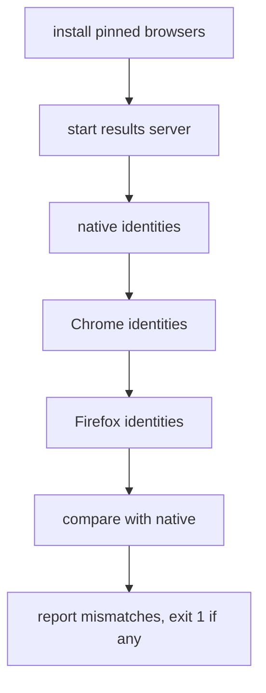

# harness.browser_check

The correctness check that CI runs: every case's
input fingerprint and checksum in headless Chrome and Firefox (pinned
builds) must equal the native ones. It is never a measurement.

```bash
python3 -m harness.browser_check [--chrome-flag=--no-sandbox]
```

## Main pieces

| File | Responsibility |
|---|---|
| `cases.py` | The cases: workloads, inputs and thread counts, and their queries |
| `identity.py` | `RunIdentity`, `read_identity` and `compare` into `Mismatch`es |
| `check.py` | Runs every case natively and in one browser |
| `cli.py`, `__main__.py` | Install browsers, serve, run, report |

## Flow


