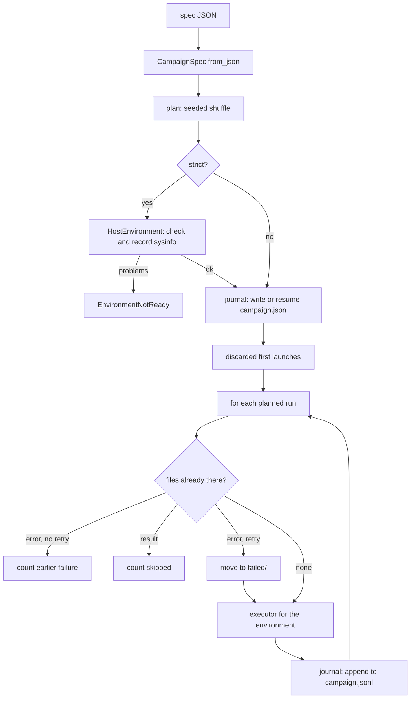

# harness.campaign

Runs a whole campaign: every configuration and repetition of a spec, in
one order shuffled with a recorded seed, interleaving native, Chrome and
Firefox. Rerunning the same spec resumes where it stopped. A
strict campaign refuses to start on a machine that is not prepared, or with a browser that is not the pinned version.

```bash
python3 -m harness.campaign harness/campaigns/smoke.json [--retry-failed]
python3 -m harness.campaign.status harness/campaigns/smoke.json
```

The second command prints the progress (done, failed, remaining, problems,
elapsed time and ETA) without touching anything; see `status/README.md`.

## Passes

`passes` (default 1) is the number of `Workload::run` calls inside each
timed sample; a workload entry may override it, like `warmup`. The run
query gets `&passes=K` only when K is not 1, and the stored spec in
`campaign.json` leaves `passes` (and the free-text `comment`) out while they
are unset, so the campaigns started before these keys resume against an
identical spec. More than one pass is refused for every workload except
`filter` and `hist-local` (`repeats_identically` in `capabilities.py`), the same rule as the
bench. The `cutoff-<side>.json` specs use it.

## Grain

`grain` is a workload key only: the fixed task size of the filter (rows)
or of `hist-local` (KB), refused for every other workload
(`takes_grain` in `capabilities.py`). Absent, the run keeps Rayon's adaptive split, and the
query and the stored spec are as before. A grain adds `&grain=g` to the
query and `-g<g>` to the workload label, so the run ids of two grains of
the same workload differ. The run's context JSON records it (`grain`,
`null` when absent). The `grain-<side>.json` specs use it.

## Pitch (v2)

`pitch` is a workload key of the filter only (`takes_pitch` in
`capabilities.py`): the row stride of the input and output images in
bytes, at least the width (the bench refuses a smaller one). Absent, the
rows are back to back as before. A pitch adds `&pitch=p` to the query and
`-p<p>` to the workload label. The checksum and the input fingerprint
cover the width of each row only, so they equal the unpadded run's.

## Palette (v2)

`palette` is a workload key of the few-colors input: `spread` (the bench's
default, values i * 256 / k) or `consecutive` (values 0..k-1), which puts
the counters of the packed histogram on shared cache lines at k = 4 and 16.
Absent, the query and the label are as before; set, it adds
`&palette=<p>` to the query and `-<p>` after the k in the label.

## Main pieces

| File | Responsibility |
|---|---|
| `workload.py` | `Workload` and `InputKind` enums, `WorkloadSpec` (one workload on one input) |
| `capabilities.py` | `Capabilities`: whether a workload repeats identically (passes) and takes a grain, declared once per workload in `workload.py` |
| `choices.py` | `parse_choice`: a spec string into its enum, with the spec's error message |
| `fields.py` | `SpecFields`: typed reads of the untyped values `json.loads` gives |
| `spec.py` | `CampaignSpec`: reads and validates the spec JSON, the passes of each workload, builds the run query |
| `planned_run.py` | `PlannedRun` and its run id |
| `plan.py` | The shuffled plan and the discarded first launches |
| `executors.py` | `NativeExecutor` and `BrowserExecutor` run one planned run |
| `gate.py` | `HostEnvironment`: the environment check of a strict campaign |
| `identity.py` | Build identity: commit, binary and JS glue digests, browser versions, runtime crate versions, Firefox profile settings |
| `journal.py` | `campaign.json` (session start and resume checks) and `campaign.jsonl` |
| `runner.py` | `Campaign`: the session from check to log; `Summary` |
| `cli.py`, `__main__.py` | Command line |
| `status/` | Read-only progress report of a campaign, running or finished (`make status`) |

## Flow


