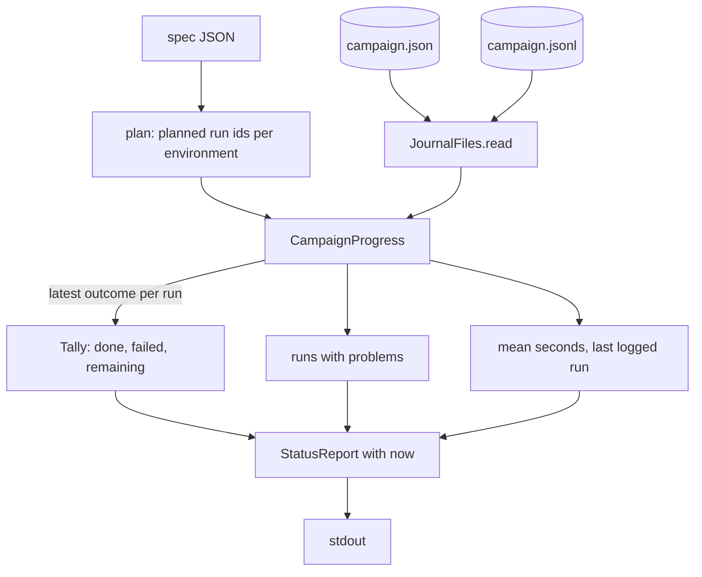

# harness.campaign.status

Prints the progress of a campaign, running or finished, from what the
campaign journal wrote: `campaign.json` (start and resumes) and
`campaign.jsonl` (one line per run). It is read-only: it never writes into
the results and never reads the machine state, so it is safe to run in a
second terminal while a campaign measures.

It reports progress, not data quality. A checksum mismatch inside a run already fails that run, which is then logged as an error. Checksum conflicts across runs, order drift and the clock checks belong to `python3 -m analysis.datacheck`, which runs once the campaign is over.

```bash
python3 -m harness.campaign.status harness/campaigns/campaign.json [--results data/raw]
make status SPEC=harness/campaigns/campaign.json
```

The planned runs come from the spec's seeded plan, so the report also works
before the first run; a warning shows when `campaign.json` lists other runs.
A run that was retried counts by its last logged outcome. Discarded first
launches are not progress, and their `orderPosition unavailable` problem
is expected, so it is not reported. The ETA is the mean
`seconds` of the logged runs times the remaining runs; it leaves out the
time between runs (teardown, browser start).

## Main pieces

| File | Responsibility |
|---|---|
| `logged_run.py` | `LoggedRun`: one line of `campaign.jsonl` |
| `journal_files.py` | `JournalFiles`: reads `campaign.json` and `campaign.jsonl`, both optional |
| `progress.py` | `CampaignProgress` and `Tally`: done, failed and remaining, overall and per environment |
| `durations.py` | `format_duration`: short durations such as `1h 02m` |
| `report.py` | `StatusReport`: the text lines, given the current time |
| `cli.py`, `__main__.py` | Command line |

## Flow


