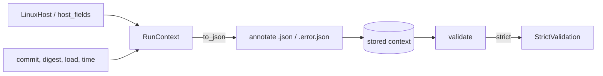

# harness.context

The context recorded with every result: host state,
launch settings and provenance, plus the checks that say whether a stored
run is complete and fit to be measured. `analysis/` imports `validate`,
`git_commit` and `utc_now` from here.

## Main pieces

| File | Responsibility |
|---|---|
| `record.py` | `RunContext` (field order = JSON key order) and `CpuTimeMethod` |
| `host.py` | `LinuxHost` and `host_fields`: CPU model, governor, turbo, SMT, topology |
| `provenance.py` | Commit, command output, file digest, load average, UTC time |
| `results.py` | `RunFiles`, reuse check and atomic `annotate` of a run's JSON |
| `validation.py` | `validate`: required keys, and the strict checks; `LATER_KEYS` are written but not required of older runs |
| `run_query.py` | `passes_of_query`: the passes of a run, recorded as `passes` in its context |
| `cpu_mask.py` | CPU masks in the kernel list format, shield overlaps |
| `sysfs.py` | Paths under `/proc` and `/sys`, `read_text` |
| `run_environment.py` | `RunEnvironment`: native, chrome, firefox |
| `unavailable.py`, `units.py`, `json_value.py` | Shared marker, rounding and JSON types |

## Flow

