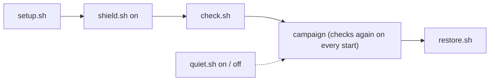

# env

Shell scripts that put the measuring PC in the state every campaign requires, check it, and
undo it. They change kernel settings through `/sys` and systemd, so `setup.sh`, `shield.sh`
and `restore.sh` need sudo; everything they set lasts until the next reboot.

| Script | Make target | What it does |
|---|---|---|
| `setup.sh [P_MASK] [E_CPUS]` | `make env-setup` | SMT off, turbo off, governor `performance`, perf counters readable, shield on, then `check.sh` |
| `check.sh [P_MASK]` | `make env-check` | Fails unless turbo is off, the governor is `performance`, SMT is off, the mask is every physical P-core and the shield is on; saves the system state |
| `shield.sh on\|off E_CPUS P_MASK` | (called by the two above) | Moves `system.slice`, `user.slice` and `init.scope` to the E-cores and checks the effective cpusets |
| `quiet.sh on\|off` | `make quiet`, `make quiet-off` | Closes desktop apps and stops background work that can burst during a run |
| `restore.sh [P_MASK] [E_CPUS]` | `make env-restore` | Shield off, SMT on, turbo on, governor `powersave`, perf counters restricted again |

`P_MASK` and `E_CPUS` default to the values of the `Makefile`, which describe the i9-14900KF
of the study. On another machine they must be changed together with the `cpus` and
`harnessCpus` of the campaign specs.

