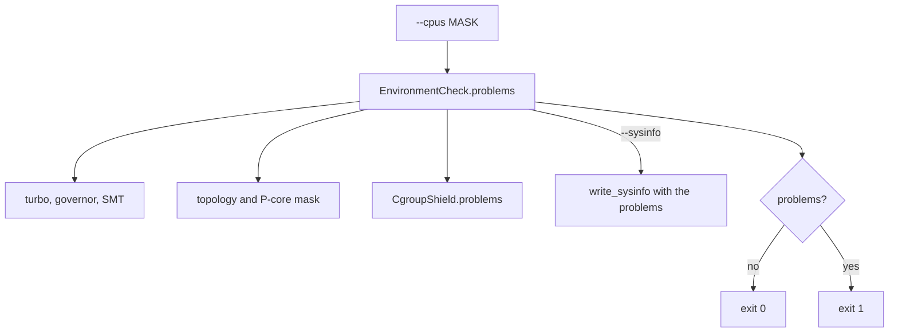

# harness.environment

Checks that the measuring machine is prepared (turbo off, governor
`performance`, SMT off, the mask is one CPU per P-core, the shield is up)
and records its state as `sysinfo`.

```bash
python3 -m harness.environment mask
python3 -m harness.environment check --cpus 0,2,4,6,8,10,12,14 [--sysinfo PATH]
```

## Main pieces

| File | Responsibility |
|---|---|
| `topology.py` | `p_core_mask`: the first CPU of every physical P-core |
| `check.py` | `EnvironmentCheck`: the list of problems for a mask |
| `sysinfo.py` | `sysinfo` record (CPU, frequencies, shield, quiet mode, versions) |
| `cli.py`, `__main__.py` | Command line |

## Flow


