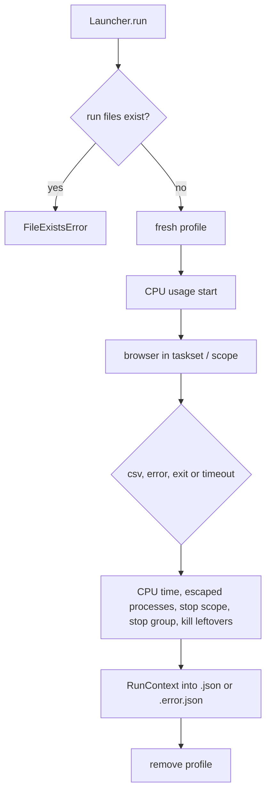

# harness.launcher

Launches one browser run with no automation framework: a fresh temporary profile, quiet browser settings,
the run configuration in the page URL and, when asked, `taskset` inside a
systemd scope. It waits until the page has posted its result to
the results server, then stops the browser, kills what it left behind and
stores the run context next to the result.

```bash
python3 -m harness.launcher --browser chrome --executable PATH --run ID --query "workload=filter&..."
```

## Main pieces

| File | Responsibility |
|---|---|
| `commands.py` | `ChromeCommand`, `FirefoxCommand`: flags, preferences and version command |
| `url.py` | `run_url`: the page URL with run id, environment and start delay |
| `launcher.py` | `Launcher`: profile, launch, wait, teardown and context |
| `outcome.py` | `RunStatus`, `RunOutcome` and what a launch recorded (the passes of the query included) |
| `processes.py` | Stopping the process group and killing leftovers on the profile |
| `cli.py`, `__main__.py` | Command line |

## Flow


