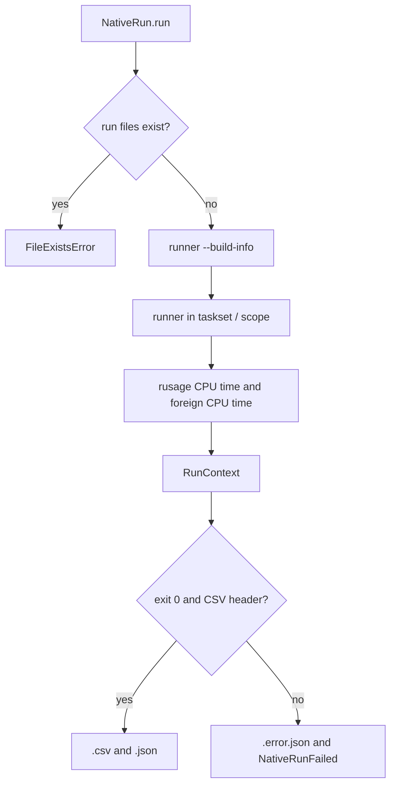

# harness.native

Runs the Rust native runner once and stores its CSV and the run context
with the same files as a browser run, so the loader
treats every environment alike.

```bash
python3 -m harness.native --run ID --query "workload=filter&input=noise&threads=8&..."
```

## Main pieces

| File | Responsibility |
|---|---|
| `interface.py` | The runner's interface: `CSV_HEADER`, `SCHEMA_VERSION`, `--build-info`, query to flags (`passes=K` becomes `--passes K`) |
| `run.py` | `NativeRun`: confine, execute, measure CPU time, store result or error |
| `cli.py`, `__main__.py` | Command line |

## Flow


