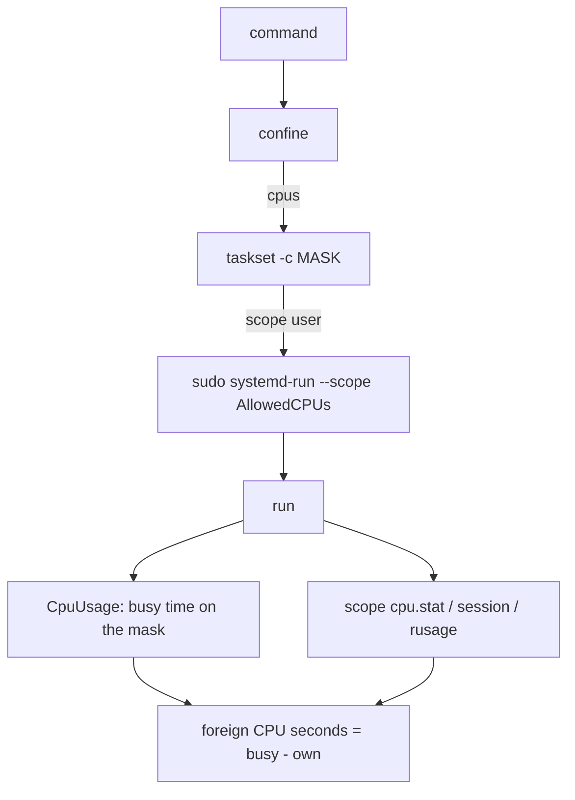

# harness.shield

Keeps the rest of the system off the measured CPUs and measures what
still lands there: the cgroup cpuset shield, the
transient systemd scope that holds every process of a run, the run's own
CPU time and the busy time of other processes on the measured CPUs.

```bash
python3 -m harness.shield check --cpus 0,2,4,6,8,10,12,14
```

## Main pieces

| File | Responsibility |
|---|---|
| `cgroup.py` | `CgroupShield`: effective cpusets of the shielded units |
| `scope.py` | The systemd scope: command prefix, stop, cgroup path and CPU time |
| `confinement.py` | `confine` (taskset, optionally in a scope), harness pinning |
| `cpu_time.py` | `CpuTimes`, `CpuUsage` and session CPU time from `/proc` |
| `processes.py` | Browser processes that escaped the run scope |
| `cli.py`, `__main__.py` | Command line |

## Flow


