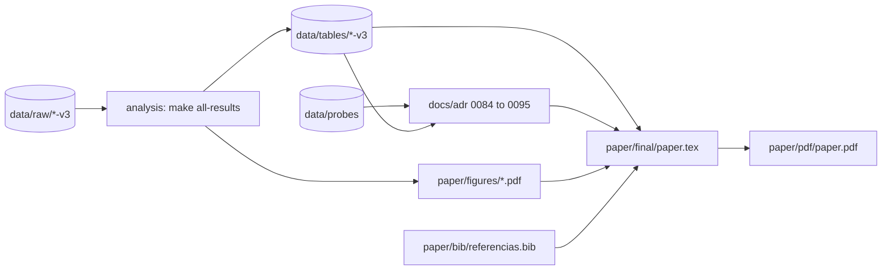

# paper

The paper of the study, in the ACM `sigplan` template of the course (5 pages of content plus 2 of
references). Every number in it is from the build `measured/v3`.

| Path | What it holds |
|---|---|
| `final/paper.tex` | The paper |
| `bib/referencias.bib` | The references of the paper |
| `figures/*.pdf` | The figures, written by the result targets from `data/raw/*-v3` (`make all-results`); never edited by hand |
| `pdf/paper.pdf` | The compiled paper that is kept |

## Building it

```sh
make all-results                      # the figures, from the measured runs
cd paper/final && tectonic -X compile paper.tex --outdir ../pdf
```

`latexmk -pdf paper.tex` works as well; the PDFs built next to the sources are ignored by git.

## Where each part of the paper comes from



| In the paper | Source |
|---|---|
| Run counts, exclusions, order trend | `data/tables/campaign-v3/campaign-v3-quality.md` |
| Speedup, efficiency (Figure 1) | `campaign-v3-scaling.csv`, `figures/campaign-efficiency-paper.pdf` |
| Primary contrasts and their 99.5 % intervals (Table 1, RQ1) | `campaign-v3-contrasts.csv`, `campaign-v3-sensitivity.csv` (columns `primary_*`) |
| Time over native (ABS rows), speedup ratio by thread count (RQ1 rows), the RQ2 effect at every N, N = 1 included (RQ2 rows, Table 1 and Figure 2) | `campaign-v3-contrasts.csv`, `figures/campaign-rq2-effect.pdf` |
| The previous build's two filter contrasts, quoted in the threats | ADR 0079, ADR 0095 |
| The analysis plan's date and the later addition of the rank test | ADR 0037 |
| The two factors of the RQ2 ratio | `campaign-v3-rq2-decomposition.csv` |
| Mann-Whitney, Cliff's delta, re-pairings | `campaign-v3-robustness.csv` |
| Spread of the runs | `campaign-v3-distributions.csv` |
| Sequential references | `campaign-v3-sequential.csv` |
| Fork-join calibration | `campaign-v3-fork-join.csv` |
| Karp-Flatt | `campaign-v3-karp-flatt.csv` |
| Engine arms (Table 2, engine rows) | `data/tables/tier-v3/tier-v3-arms.csv`, ADR 0089 |
| Native probe (Table 2, probe rows) | `data/probes/atomic-increment/README.md` |
| Increment sequences, instructions per pixel of the listings | `data/probes/engine-code/README.md` |
| Retries per add, time against line transfers | `data/tables/perf-v3/perf-v3-retries.csv`, ADR 0091 |
| Counters of the loop alone (Table 3) | `data/tables/perf-loop-v3/`, ADR 0090, ADR 0091 |
| SIMD variants | `data/tables/simd-v3/simd-v3-variants.csv`, ADR 0091 |
| Private and packed atomics | `data/tables/extras-v3/extras-v3-scaling.csv`, ADR 0093 |
| Weak scaling | `data/tables/weak-v3/weak-v3-scaling.csv`, ADR 0092 |
| E-cores | `data/tables/hybrid-v3/hybrid-v3-scaling.csv`, ADR 0094 |
| Small regions | `data/tables/cutoff-v3/cutoff-table.csv`, `cutoff-estimates.csv`, `cutoff-model.csv` |
| Granularity | `data/tables/grain-v3/grain-points.csv`, `grain-best.csv`, ADR 0092 |
| Per-core check, the gate, the two builds | ADR 0085, ADR 0086, ADR 0087 |
| Pilot facts in the methodology (E-cores, headful, start delay, mask escape) | ADR 0045, ADR 0046, ADR 0048 |
| Threats to validity | ADR 0080, as amended by ADR 0085, 0087 and 0091 |
