# presentation

The slides of the final presentation of the study, for Programação Paralela e Concorrente
2026/27: twelve slides for about ten minutes, plus five backup slides for questions. One HTML
file that works offline from `file://`, with no build step, no CDN and no external font.

| File | What it holds |
|---|---|
| `index.html` | The deck: styles, the slides, the speaker notes (`<aside class="notes">` in each slide), the numbers the charts are drawn from (`DATA` in the script) and the deck's behaviour |

## How to present

Open `index.html` in a browser and press `F` for fullscreen. The deck is drawn on a fixed
1920x1080 stage and scaled to the window, so it looks the same on the laptop and the projector.

| Key | What it does |
|---|---|
| Right arrow, space, Page Down | Next step of the slide, then the next slide |
| Left arrow, Page Up | Previous step or slide |
| Home, End | First slide, last slide of the talk (Questions) |
| `N` | Speaker notes, with the elapsed time against the budget up to the current slide |
| `T` | Reset the timer (it starts on the first step forward) |
| `O` | Overview of every slide; click one or press Escape |
| `B` | Jump to the backup slides, and back to Questions |
| `F`, `?` | Fullscreen, help |

`index.html?static` shows every step at once with the animations off. To export a PDF, open it
with `?static` and print with no margins: each slide is one 1920x1080 page.
`index.html#7` opens slide 7. The deck honours `prefers-reduced-motion`.

## The talk

```mermaid
flowchart LR
    title["1 Title<br/>20 s"] --> why["2 Why and the RQs<br/>45 s"]
    why --> design["3 One source, three environments<br/>55 s"]
    design --> method["4 Method and rigor<br/>70 s"]
    method --> rq1["5 RQ1 result<br/>60 s"]
    rq1 --> rq1why["6 RQ1 explanation<br/>65 s"]
    rq1why --> rq2["7 RQ2 result<br/>55 s"]
    rq2 --> rq2why["8 RQ2 explanation<br/>80 s"]
    rq2why --> pitfalls["9 Pitfalls of browser benchmarking<br/>45 s"]
    pitfalls --> threats["10 Threats and open questions<br/>40 s"]
    threats --> takeaways["11 Takeaways<br/>45 s"]
    takeaways --> questions["12 Questions<br/>20 s"]
    questions -.-> backup["B1 to B5: extras, weak scaling and SIMD,<br/>cutoff and grain, E-cores, robustness"]
```

The budgets add up to 600 s.

## Where every number comes from

Every number is from the build `measured/v3`. The charts are drawn in the page from the values
in `DATA`; nothing is a picture of a figure. Tables are under `data/tables/`, records under
`docs/adr/`.

| Slide | Number | Source |
|---|---|---|
| 1 | Block speeds 1.00, 1.17, 1.36 | `campaign-v3/campaign-v3-contrasts.csv`, `ABS`, filter, N = 1 |
| 4 | Warm-up 5 to 71, 10 iterations, 30 runs, N values, 3 s delay, seeded order | `harness/campaigns/campaign-v3.json` |
| 4 | 177 configurations, 5310 runs, none failed or excluded, no checksum conflict, clock factor | `campaign-v3/campaign-v3-quality.md`, `campaign-v3-contrasts.json` |
| 4 | 10 primary contrasts, 10 000 resamples, Holm at 0.05, 99.5 % intervals | `campaign-v3/campaign-v3-contrasts.json`, ADR 0037 |
| 5 | Speedup curves and the values at N = 8 | `campaign-v3/campaign-v3-scaling.csv` |
| 5 | 0.996 [0.987, 1.004] and 1.055 [1.034, 1.072] | `campaign-v3/campaign-v3-sensitivity.csv`, `primary_*` columns |
| 5 | Time over native 1.17, 1.18, 1.36, 1.29 | `campaign-v3/campaign-v3-contrasts.csv`, `ABS`, filter, N = 1 and 8 |
| 5 | Pool of one thread within -7 % to +5 % of sequential code | `campaign-v3/campaign-v3-sequential.csv`, ADR 0091 |
| 6 | Instructions and cycles per pixel | `perf-loop-v3/perf-loop-v3-counters.csv`, ADR 0091 (question 3) |
| 6 | MB/s with one thread against efficiency at N = 8 | `simd-v3/simd-v3-variants.csv`, ADR 0091 (question 1) |
| 6 | Fork-join 7.9, 110 and 60 microseconds | `campaign-v3/campaign-v3-fork-join.csv`, all workloads, N = 8, broadcast, warm, median |
| 6, 11 | 0.4 to 0.5 ms of work per region (0.12 natively) | `cutoff-v3/cutoff-estimates.csv`, worth-it at N = 8 |
| 7 | The eight RQ2 effects and their 99.5 % intervals | `campaign-v3/campaign-v3-sensitivity.csv`, `primary_*` columns |
| 7 | Atomic speedups 0.36 to 0.70; 698 and 380 ms | `campaign-v3/campaign-v3-scaling.csv` |
| 8 | The four instruction sequences | `data/probes/engine-code`, ADR 0088, ADR 0089 |
| 8 | One-thread times of the arms and of the native probe; 210, 240 and 415 ms; 2.17 and 1.04 | ADR 0089, `tier-v3/tier-v3-arms.csv`, `data/probes/atomic-increment` |
| 8 | Retries per add 0.24, 0.001, 0.002 | `perf-v3/perf-v3-retries.csv` |
| 9 | The five pitfalls | ADR 0045, ADR 0048, ADR 0071, ADR 0085, ADR 0069 and ADR 0086 |
| 10 | Limits and open questions | ADR 0080, ADR 0091 |
| 12 | 21 840 exploratory runs | sum of the runs of ADR 0089 and ADR 0091 to 0094 |
| B1 | Private, packed and padded atomics, sorts | `extras-v3/extras-v3-scaling.csv`, ADR 0093 |
| B2 | Weak scaling; SIMD builds | `weak-v3/weak-v3-scaling.csv`; `simd-v3/simd-v3-variants.csv` |
| B3 | Cutoff work and sides; best grains | `cutoff-v3/cutoff-estimates.csv`, `cutoff-model.csv`; `grain-v3/grain-best.csv`, ADR 0092 |
| B4 | Speedups up to N = 20 | `hybrid-v3/hybrid-v3-scaling.csv`, ADR 0094 |
| B5 | Sensitivity checks, Cliff's delta, Mann-Whitney | `campaign-v3/campaign-v3-sensitivity.csv`, `campaign-v3-robustness.csv` |

The animation of slide 8 is an illustration of the two sequences, with made-up counter values;
the title's lanes are an illustration whose block speeds are the three measured ratios above.
