# presentation

The slides of the final presentation of the study, for Programação Paralela e Concorrente
2026/27: twelve slides for about ten minutes, four of them with a demonstration that the
presenter drives, plus six backup slides for questions. One HTML file that works offline from
`file://`, with no CDN and no external font.

| File | What it holds |
|---|---|
| `index.html` | The deck: styles, the slides, the speaker notes (`<aside class="notes">` in each slide), the numbers the charts are drawn from (`DATA` and `DEMO` in the script), the demos and the deck's behaviour |
| `build_data.py` | Writes the `DEMO` block of `index.html` from the `measured/v3` tables, the campaign's journal, one run's CSV and the probe's README, so no number of a demo is typed by hand: `python3 presentation/build_data.py` from the repository root |

## How to present

Open `index.html` in a browser and press `F` for fullscreen. The deck is drawn on a fixed
1920x1080 stage and scaled to the window, so it looks the same on the laptop and the projector.

| Key | What it does |
|---|---|
| Right arrow, space, Page Down | Next step of the slide, then the next slide |
| Left arrow, Page Up | Previous step or slide |
| Home, End | First slide, last slide of the talk (Questions) |
| `N` | Speaker notes, with the elapsed time against the budget up to the current slide |
| `T` | Reset the timer (it starts on the first step forward) |
| `O` | Overview of every slide; click one or press Escape |
| `B` | Jump to the backup slides, and back to Questions |
| `F`, `?` | Fullscreen, help |
| Up, Down, `1` to `4`, `R` | On a slide with a demo: its controls (see below). They never change the slide |

`index.html?static` shows every step at once with the animations off and each demo in its
default state. To export a PDF, open it
with `?static` and print with no margins: each slide is one 1920x1080 page.
`index.html#7` opens slide 7. The deck honours `prefers-reduced-motion`.

## How to drive each demo

Every control is a button on the slide and a key. Clicking a control does not advance the
slide, and the keys below do not either, so a presenter remote that sends Left, Right, Up and
Down drives everything. Untouched, each demo plays its own story.

| Slide | Demo | Untouched | Keys |
|---|---|---|---|
| 4 | The anatomy of one run, then the 5310 runs | The timeline of one run plays on entry; the next step drops the 5310 runs into the three environments in the order the campaign ran; the step after shows the analysis plan | `R` replays the timeline (first step) or the fill (later steps) |
| 5 | Speedup and efficiency by N | The cores light up from 1 to 8 for the filter and stop at 8; the next step shows the primary contrast | Up and Down change N (1, 2, 4, 6, 7, 8); `1` filter, `2` local histogram k = 256, `3` atomic k = 1, `4` atomic k = 256 |
| 6 | Efficiency and the size of a parallel region | When its column appears (second step) it walks from 8192 down to 512 and stays there | Up and Down change the image side (512, 1024, 2048, 4096, 8192) |
| 8 | Eight cores, k counters, three increment sequences | Entry: locked add at k = 1. Next step: compare-and-swap at k = 1. Next: compare-and-swap at k = 256. Next: the conclusion | `1` locked add, `2` load and compare-and-swap, `3` exchange-and-add; Up and Down change k (1, 4, 16, 256); `R` restarts the model |

The picture of slide 8 is a model, and the slide says so: eight cores take turns at a cache
line, and with the compare-and-swap a line that another core is waiting for is taken between
the load and the write once in five such moments. That rate is set so that the model gives
about the share of retried adds that the counters measured in Chrome at k = 1 (0.24). The
table next to the model holds only measured times, and says "not measured" where a cell has
none (the probe has no k = 4; the baseline arm has k = 1 and 256 only).

On slide 6 one empty fork-join is shown next to the time of a parallel region as a yardstick,
not as a share of it: the fork-join is measured by each run's calibration, and at 512 x 512 a
whole region in Chrome takes less than it.

## The talk

```mermaid
flowchart LR
    title["1 Title<br/>15 s"] --> why["2 Why and the RQs<br/>45 s"]
    why --> design["3 One source, three environments<br/>55 s"]
    design --> method["4 Method: the anatomy of a run<br/>75 s"]
    method --> rq1["5 RQ1 result<br/>65 s"]
    rq1 --> rq1why["6 RQ1 explanation<br/>65 s"]
    rq1why --> rq2["7 RQ2 result<br/>55 s"]
    rq2 --> rq2why["8 RQ2 explanation<br/>85 s"]
    rq2why --> pitfalls["9 Pitfalls of browser benchmarking<br/>40 s"]
    pitfalls --> threats["10 Threats and open questions<br/>40 s"]
    threats --> takeaways["11 Takeaways<br/>40 s"]
    takeaways --> questions["12 Questions<br/>20 s"]
    questions -.-> backup["B1 to B6: extras, weak scaling and SIMD,<br/>cutoff and grain, E-cores, robustness,<br/>engine arms and probe"]
```

The budgets add up to 600 s.

## Where every number comes from

Every number is from the build `measured/v3`. The charts are drawn in the page from the values
in `DATA` and `DEMO`; nothing is a picture of a figure. Tables are under `data/tables/`, records under
`docs/adr/`.

| Slide | Number | Source |
|---|---|---|
| 1 | Block speeds 1.00, 1.17, 1.36 | `campaign-v3/campaign-v3-contrasts.csv`, `ABS`, filter, N = 1 |
| 4 | Warm-up 5 to 71, 10 iterations, 30 runs, N values, 3 s delay, seeded order | `harness/campaigns/campaign-v3.json` |
| 4 | 177 configurations, 5310 runs, none failed or excluded, no checksum conflict, clock factor | `campaign-v3/campaign-v3-quality.md`, `campaign-v3-contrasts.json` |
| 4 | 10 primary contrasts, 10 000 resamples, Holm at 0.05, 99.5 % intervals | `campaign-v3/campaign-v3-contrasts.json`, ADR 0037 |
| 4 | The warm-up and measured bars and the run's value 3.79 ms | `data/raw/campaign-v3/campaign-v3-0188-chrome-filter-noise-n8-r1.csv` (`warmup` and `measured` rows) |
| 4 | The order in which the 5310 cells fill | `data/raw/campaign-v3/campaign.jsonl`, the `position` of each run |
| 5 | Time, speedup, efficiency and their 95 % intervals at every N, for the four workloads; time / native is the ratio of two times of the table | `campaign-v3/campaign-v3-scaling.csv` |
| 5 | 0.996 [0.987, 1.004] and 1.055 [1.034, 1.072] | `campaign-v3/campaign-v3-sensitivity.csv`, `primary_*` columns |
| 5 | Time over native 1.17, 1.18, 1.36, 1.29 | `campaign-v3/campaign-v3-contrasts.csv`, `ABS`, filter, N = 1 and 8 |
| 5 | Pool of one thread within -7 % to +5 % of sequential code | `campaign-v3/campaign-v3-sequential.csv`, ADR 0091 |
| 6 | Instructions and cycles per pixel | `perf-loop-v3/perf-loop-v3-counters.csv`, ADR 0091 (question 3) |
| 6 | MB/s with one thread against efficiency at N = 8 | `simd-v3/simd-v3-variants.csv`, ADR 0091 (question 1) |
| 6 | Efficiency at N = 8 and T8 per image side | `cutoff-v3/cutoff-table.csv`, filter, N = 8 (`efficiency`, `tn_ns`) |
| 6 | Empty fork-join 10.8, 105 and 60 microseconds | `cutoff-v3/cutoff-model.csv` (`fork_join_us`, the calibration of the cutoff campaigns) |
| 11 | About 0.5 ms of work per region (0.12 natively) | `cutoff-v3/cutoff-estimates.csv`, worth-it at N = 8 |
| 7 | The eight RQ2 effects and their 99.5 % intervals | `campaign-v3/campaign-v3-sensitivity.csv`, `primary_*` columns |
| 7 | Atomic speedups 0.36 to 0.70; 698 and 380 ms | `campaign-v3/campaign-v3-scaling.csv` |
| 8 | The four instruction sequences | `data/probes/engine-code`, ADR 0088, ADR 0089 |
| 8 | Engine rows of the table at k = 1 and 256 (native, Firefox optimizing, Chrome optimizing, Chrome baseline) | `tier-v3/tier-v3-arms.csv` |
| 8 | Engine rows at k = 4 and 16 (native, Firefox, Chrome as shipped) | `campaign-v3/campaign-v3-scaling.csv`: the tier campaign has k = 1 and 256 only |
| 8 | Probe rows | the result table of `data/probes/atomic-increment/README.md` |
| 8 | Retries per add under the table | `perf-v3/perf-v3-retries.csv` |
| 8 | Effect 2.17 and 1.04 | ADR 0089 |
| 9 | The five pitfalls | ADR 0045, ADR 0048, ADR 0071, ADR 0085, ADR 0069 and ADR 0086 |
| 10 | Limits and open questions | ADR 0080, ADR 0091 |
| 12 | 21 840 exploratory runs | sum of the runs of ADR 0089 and ADR 0091 to 0094 |
| B1 | Private, packed and padded atomics, sorts | `extras-v3/extras-v3-scaling.csv`, ADR 0093 |
| B2 | Weak scaling; SIMD builds | `weak-v3/weak-v3-scaling.csv`; `simd-v3/simd-v3-variants.csv` |
| B3 | Cutoff work and sides; best grains | `cutoff-v3/cutoff-estimates.csv`, `cutoff-model.csv`; `grain-v3/grain-best.csv`, ADR 0092 |
| B4 | Speedups up to N = 20 | `hybrid-v3/hybrid-v3-scaling.csv`, ADR 0094 |
| B5 | Sensitivity checks, Cliff's delta, Mann-Whitney | `campaign-v3/campaign-v3-sensitivity.csv`, `campaign-v3-robustness.csv` |
| B6 | Engine arms; native probe | `tier-v3/tier-v3-arms.csv`; `data/probes/atomic-increment/README.md` |

The title's lanes are an illustration whose block speeds are the three measured ratios above.
