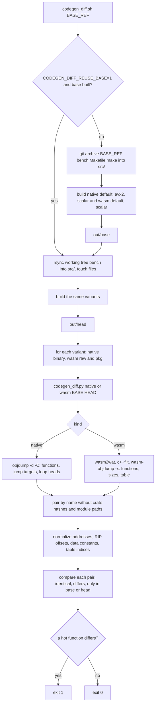

# scripts

Repository checks that are not part of the study itself: ADR structure, SIMD
parity of the built artifacts and the codegen-neutral check of a `bench/`
refactor, plus the script behind the hardware counters extra. Standard library
only; `mypy --strict` covers them (`make lint`).

| File | What it does | Who calls it |
|---|---|---|
| `check_adrs.py` | Every `docs/adr/NNNN-*.md` and `docs/adr/extras/NNNN-*.md` has a matching title, a `Date:` line, the four required sections and a unique number | `make lint`, CI (`python` job) |
| `check_simd.py` | `blur_interior` in an `objdump`/`wasm-objdump` listing contains packed 16-bit arithmetic | CI (`rust` job), on the final native binary and `bench.wasm` |
| `codegen_diff.sh` | Builds a base ref and the working tree of `bench/` at the same path, every native and WASM variant, then runs `codegen_diff.py` on each pair | By hand, before merging a change in `bench/src`: `bash scripts/codegen_diff.sh [BASE_REF]` |
| `codegen_diff.py` | Pairs the functions of two builds by name, normalizes addresses and data offsets, and reports which differ; exit 1 if a hot function differs. It also lists the hot patterns that name no function in a build: those items were inlined into a caller, which is then the function to read (in the WASM build the measurement loop is inside `bench::run`) | `codegen_diff.sh`, or by hand on two artifacts |
| `tables_diff.py` | Compares every file under `data/tables` with the committed one after a regeneration, ignoring a sidecar's `commit` and `createdAt`; exit 1 if a table differs, is new or was not regenerated | `make tables-check`, CI (`tables` job) |
| `perf-counters.sh` | Extra: runs the perf campaign of `MEASURED` while `perf stat` counts the P-cores in 100 ms intervals | By hand, on the PC, nothing else running: `bash scripts/perf-counters.sh` |
| `session.sh`, `lib/steps.sh` | One stage of the measuring session of a build (`preflight`, `build`, `gate`, `main`, `extras`) as numbered steps that resume where they stopped; logs and progress in `data/sessions/<build>/<stage>/` | By hand, on the PC: `make session STAGE=<stage>` |
| `build_twice.sh` | Builds the native runner and the WASM package twice from scratch and fails unless the digests agree | `session.sh build` |
| `kernel_code.py` | Extracts each kernel's function and its main loop from a native binary and a WASM module | By hand: `python3 -m scripts.kernel_code` (see `data/probes/engine-code/README.md`) |
| `capture_chrome.py`, `chrome_code.py` | One diagnostic Chrome run per kernel and compiler with V8 writing its compiled code, and the extraction of each kernel from those dumps | By hand, on the PC, no campaign running |
| `tests/` | unittest suite of the checks (`python3 -m unittest discover -s scripts/tests -t .`) | `make test-python`, CI (`python` job) |

## codegen_diff

`codegen_diff.sh` takes `CODEGEN_DIFF_WORK` (scratch directory, default
`${TMPDIR:-/tmp}/codegen-diff`) and `CODEGEN_DIFF_REUSE_BASE=1` (keep the
base artifacts of an earlier run). Both sides are built in the same
directory, so embedded paths such as panic locations do not differ.

